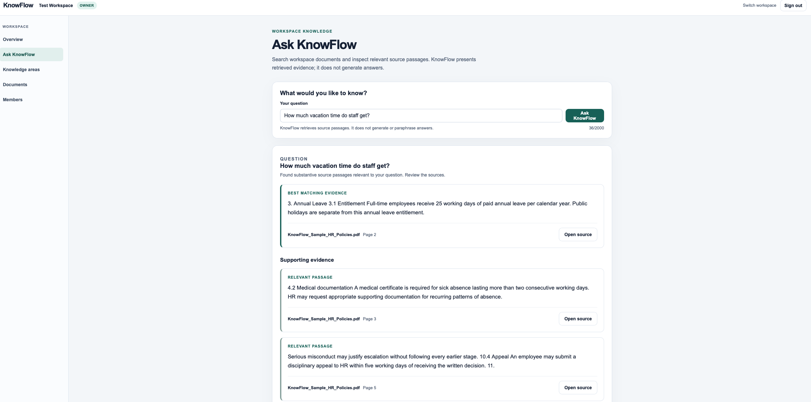

# KnowFlow

**Business Knowledge & Document Intelligence Platform**

KnowFlow is a full-stack document intelligence platform that enables teams to securely organize business documents and retrieve evidence-backed information using natural-language questions.

Rather than generating unverifiable answers, KnowFlow combines semantic vector search and full-text search to retrieve relevant passages with document and page-level provenance.

[Live Demo](https://knowflow-web.onrender.com) 

> The live demo runs on free-tier infrastructure and may take a short time to wake after inactivity.

## Demo

<!-- Add screenshot here -->



## Key Features

- Multi-tenant workspaces with Owner and Member authorization
- Secure private PDF upload, viewing and deletion
- Durable asynchronous document-processing pipeline
- Page-aware PDF extraction and deterministic chunking
- Local E5 semantic embeddings
- PostgreSQL full-text search + pgvector semantic search
- Reciprocal Rank Fusion (RRF) hybrid retrieval
- Evidence-backed natural-language Q&A
- Document and page-level source provenance
- Protected source viewing and downloads
- Responsive Next.js interface
- WorkOS authentication

## Architecture

### Hosted Demo

Next.js / TypeScript
        ↓
FastAPI / Python
        ↓
PostgreSQL + pgvector + FTS
        ↓
Private Object Storage

Document processing:
PDF → Extraction → Chunking → E5 Embeddings → pgvector

Retrieval:
Question
   ├── PostgreSQL Full-Text Search
   └── E5 Semantic Search
              ↓
             RRF
              ↓
     Evidence Selection
              ↓
   Source + Page Provenance

The hosted portfolio deployment uses Render, Neon PostgreSQL/private object storage, WorkOS AuthKit and a quantized ONNX E5-small-v2 embedding model.

## How KnowFlow Works

### 1. Document processing

Uploaded PDFs are stored privately and registered as durable PostgreSQL processing jobs.

The worker:

1. extracts selectable text page by page;
2. creates deterministic page-aware chunks;
3. generates 384-dimensional E5 embeddings;
4. stores the resulting vectors using pgvector.

Processing uses leases, retries and recovery so jobs remain durable across application restarts.

### 2. Hybrid retrieval

Questions are searched using two independent retrieval methods:

- **Semantic:** E5-small-v2 embeddings + pgvector cosine similarity
- **Lexical:** PostgreSQL full-text search

The ranked results are combined using **Reciprocal Rank Fusion (RRF)**.

### 3. Evidence-backed Q&A

KnowFlow V1 deliberately does not use a generative LLM.

Instead of generating or paraphrasing an answer, it selects relevant passages from authorized documents and presents the original evidence together with document and page provenance.

This keeps the result inspectable and avoids dependence on a paid inference API.

## Tech Stack

| Layer | Technology |
| --- | --- |
| Frontend | Next.js, React, TypeScript |
| Backend | FastAPI, Python 3.12 |
| Database | PostgreSQL, SQLAlchemy, Alembic |
| Retrieval | pgvector, PostgreSQL FTS, RRF |
| Embeddings | E5-small-v2 |
| Production inference | ONNX Runtime |
| Authentication | WorkOS AuthKit |
| Document processing | pypdf |
| Object storage | S3-compatible private storage |
| Infrastructure | Docker Compose, Render, Neon |
| CI | GitHub Actions |

## Multi-Tenant Security

WorkOS handles authentication while KnowFlow maintains its own workspace authorization model.

All document, Knowledge Area, retrieval and membership operations are workspace-scoped. Private PDFs are accessed through authenticated application routes rather than public object-storage URLs.

## Local Development

```sh
cp .env.example .env
docker compose up --build -d
docker compose run --rm api alembic upgrade head