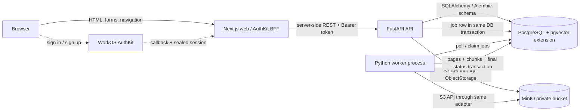
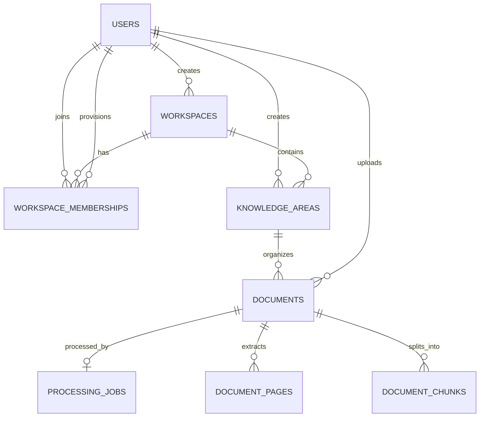

# KnowFlow Engineering Guide

**Codebase coverage:** M1 Foundation through M7 UI, UX & Application Hardening
**Purpose:** understand the implementation well enough to navigate, debug, and explain it.
**Scope boundary:** M6 presents verbatim evidence returned by M5 retrieval. V1 has no generative LLM, generated answer, or persisted conversation.

KnowFlow is currently a modular application with a Next.js server-rendered frontend, a FastAPI backend, PostgreSQL, private S3-compatible object storage (MinIO locally), and a separate Python worker process. WorkOS authenticates people; KnowFlow's database decides workspace access. M4 takes a stored text-based PDF and persists extracted pages and deterministic page-aware chunks. This guide follows those paths through the real files and tests.

## 1. System architecture

The browser talks to Next.js. Next.js uses AuthKit on the server and forwards a short-lived WorkOS bearer token to FastAPI. FastAPI verifies the token, maps its immutable subject to a local `User`, checks KnowFlow workspace membership, then reads or writes PostgreSQL and private object storage. The worker is a separate process built from the backend codebase; it polls PostgreSQL and processes uploaded files from object storage.



| Component | Responsibility in this implementation |
|---|---|
| Browser | Displays the Next.js pages and submits forms. It does not call FastAPI directly for authenticated product pages. |
| `apps/web` | Server-rendered UI, WorkOS AuthKit session handling, server actions, and authenticated API forwarding. The browser session is held by the web app; server components/actions use the access token. |
| `backend/app` API | FastAPI routes, authentication verification, internal user mapping, membership/role policies, use-case services, document storage access, and health checks. |
| PostgreSQL | System of record for users, workspaces, memberships, areas, document metadata, jobs, extracted pages, and chunks. `pgvector` is enabled but M4 does not store vectors. |
| MinIO | Local private storage of original PDF bytes. The backend uses an S3-compatible adapter rather than MinIO-specific application code. |
| Worker | Polls the durable job table, claims one eligible row, downloads and processes its PDF, then commits output and state. It is not a separate microservice codebase. |

Current authenticated browser-to-API traffic is server-to-server from Next.js to FastAPI. For document content, a Next.js route handler streams the authorized FastAPI response back to the browser. The FastAPI API independently enforces access; hiding controls in the UI is not treated as security.

## 2. Repository structure

The following tree omits dependency folders and generated build artifacts.

```text
knowflow/
|--  .env.example
|--  docker-compose.yml
|--  README.md
|--  .github/workflows/ci.yml
|--  apps/web/
|   |--  Dockerfile
|   |--  src/
|       |--  proxy.ts
|       |--  lib/api.ts
|       |--  app/
|           |--  actions.ts
|           |--  callback/route.ts
|           |--  sign-in/route.ts
|           |--  sign-up/route.ts
|           |--  api/workspaces/[workspaceId]/documents/[documentId]/content/route.ts
|           |--  api/workspaces/[workspaceId]/ask/route.ts
|           |--  workspaces/...
|--  backend/
|   |--  Dockerfile
|   |--  alembic.ini
|   |--  pyproject.toml
|   |--  app/
|   |   |--  main.py, core/, db/, api/
|   |   |--  identity/, tenancy/, knowledge_areas/, documents/, search/
|   |   |--  jobs/, processing/
|   |--  migrations/
|   |   |--  env.py
|   |   |--  versions/0001...0004...
|   |--  tests/
|--  docs/
|   |--  adr/0001...0009...
|   |--  knowflow-blueprint.md
|   |--  knowflow-v1-design.md
|   |--  samples/KnowFlow_Sample_HR_Policies.pdf
|   |--  samples/KnowFlow_Sample_Information_Security_Policy.pdf
```

### Frontend paths

| Path | Purpose and relationships |
|---|---|
| `apps/web/src/app/sign-in/route.ts`, `sign-up/route.ts` | Redirect the browser to AuthKit-generated WorkOS URLs. |
| `apps/web/src/app/callback/route.ts` | AuthKit callback handler. It validates the sign-in flow and establishes the web session. |
| `apps/web/src/proxy.ts` | Runs `authkitProxy()` on the configured routes. Its matcher covers the root, auth routes, workspace pages, and document content route. |
| `apps/web/src/lib/api.ts` | `apiFetch` obtains the server-side AuthKit user/token, adds the bearer header, calls `API_INTERNAL_BASE_URL`, and disables caching. |
| `apps/web/src/app/actions.ts` | Server actions submit workspace, membership, area, upload, retry, deletion, and sign-out operations. `authorizedFetch` forwards the bearer token. |
| `apps/web/src/app/error.tsx` | Generic, retryable application error page that does not render exception messages or internals. |
| `apps/web/src/app/workspaces/[workspaceId]/layout.tsx` | Fetches the authorized workspace on the server and renders the shared shell around all workspace routes. A missing/inaccessible workspace becomes a 404. |
| `apps/web/src/app/workspaces/[workspaceId]/WorkspaceNavigation.tsx` | Client-only active-link state using `usePathname`; the links retain the selected workspace. It receives no API token. |
| `apps/web/src/app/workspaces/[workspaceId]/page.tsx` | Lightweight overview using existing area, document, and Owner member endpoints. It adds no analytics backend. |
| `apps/web/src/app/workspaces/[workspaceId]/members/page.tsx` | Member list for workspace users and Owner-only add/change/remove controls. Server actions and FastAPI still enforce permissions. |
| `apps/web/src/app/workspaces/...` | Server components fetch scoped data and render knowledge-area, document list/detail, and Ask screens inside the shared shell. |
| `apps/web/src/app/components/ConfirmSubmit.tsx` | Inline, keyboard-operable confirmation before destructive membership, area, or document actions. |
| `apps/web/src/app/components/PendingSubmitButton.tsx` | Uses React form status to prevent repeated submissions and show a pending label. |
| `apps/web/src/lib/ui-helpers.mjs` | UI-only Owner/Member capabilities, readable status labels, and safe Ask error text; unit tested with Node's built-in runner. |
| `apps/web/src/lib/require-api-success.ts` | Preserves 404/not-found semantics and sends other failed API responses to the safe app error boundary. |
| `apps/web/src/app/api/workspaces/[workspaceId]/documents/[documentId]/content/route.ts` | Authenticated Next.js streaming proxy for inline PDF display and download. |
| `apps/web/src/app/api/workspaces/[workspaceId]/ask/route.ts` | Authenticated BFF proxy for evidence-oriented Ask; upstream network failures return a safe 503 message. |

### Backend paths

| Path | Purpose and relationships |
|---|---|
| `backend/app/main.py` | Builds the FastAPI app, mounts routers, installs error handlers, and adds request IDs. |
| `backend/app/core/config.py`, `errors.py` | Validated environment settings and consistent public API error envelopes. |
| `backend/app/db/models.py`, `session.py` | SQLAlchemy schema and per-process engine/session factory. Alembic imports `Base.metadata` from the models. |
| `backend/app/identity/` | Verifies WorkOS JWTs, fetches trusted WorkOS profiles when needed, maps subjects to local users, exposes `/me`. |
| `backend/app/tenancy/` | Workspace membership and Owner/Member policy, API, and service logic. |
| `backend/app/knowledge_areas/` | Knowledge Area REST routes, validation schemas, and workspace-scoped service functions. |
| `backend/app/documents/` | PDF boundary validation, object-storage port/adapter, upload/list/download/delete/retry use cases, deletion lifecycle. |
| `backend/app/jobs/` | Durable job claim, lease renewal, retry scheduling, polling worker entry point. |
| `backend/app/processing/` | PDF extraction, normalization, deterministic chunking, and atomic persistence. |
| `backend/migrations/` | Alembic environment and four ordered schema revisions. Migrations are applied explicitly. |
| `backend/tests/` | Unit/API tests, isolated identity/DB fixtures, and one real-PostgreSQL locking test. |

There is no separate repository layer. Services contain SQLAlchemy queries directly. Routers parse HTTP input and dependencies, then call services; services enforce policy/use cases and access the database or storage abstraction.

## 3. Database models

All current models are declared in `backend/app/db/models.py` using SQLAlchemy 2 typed mappings. IDs use UUIDs. Timestamps generally use PostgreSQL `now()` defaults. Workspace-owned records carry `workspace_id` and are queried with it.



`created_by` and `uploaded_by` also reference `users`; these audit/provenance links are omitted from the simplified cardinality picture. The page and chunk rows point to a document and workspace; their Knowledge Area is reached through `documents.knowledge_area_id`, not duplicated on every derived row.

| Model | Purpose, important fields and constraints |
|---|---|
| `User` | Internal KnowFlow identity. `id` is the application UUID. `auth_subject` is unique and stores the immutable WorkOS `sub`; normalized `email` is unique and checked to equal `lower(trim(email))`. Email is profile data, not the authorization key. `email_verified`, optional `display_name`, and timestamps support account display/provisioning. `memberships` cascades as ORM-owned membership rows. |
| `Workspace` | Tenant root with UUID `id`, `name`, globally unique generated `slug`, `created_by` FK to `users` (`RESTRICT`), and timestamps. Check prevents blank name. `memberships` is the association relationship. |
| `WorkspaceMembership` | Authorization record. Composite primary key `(workspace_id, user_id)` prevents duplicate membership. Both FKs cascade when the workspace or user is deleted; `created_by` is a restricted user FK. The role check allows only `OWNER` or `MEMBER`. Indexes support lookups by user/workspace and workspace/role. |
| `KnowledgeArea` | A named organizational grouping scoped by `workspace_id`. `normalized_name` is lowercased/trimmed and unique within the workspace; checks enforce nonempty name and normalization. It has `created_by`, optional description, timestamps, and `(workspace_id, name)` index. A unique `(workspace_id, id)` key exists so documents can use a composite same-workspace FK. |
| `Document` | PDF metadata and lifecycle, not file bytes. Includes workspace/area/uploader IDs; original filename; opaque unique `storage_key`; fixed `application/pdf`; byte size, page count, SHA-256; status; soft-delete timestamp; cleanup completion/error/purge timestamps; processing error code/message; and timestamps. Checks enforce PDF type, positive size/pages, known states, digest length, and that `purge_after` only follows completed storage cleanup. Composite FK `(workspace_id, knowledge_area_id)` ensures the area belongs to the same workspace; workspace and uploader FKs restrict deletion. Indexes support workspace+area listing, workspace listing, and purge time. |
| `ProcessingJob` | One processing job per `(workspace_id, document_id)` enforced by `uq_job_per_document`. Stores `job_type`, status, attempt and maximum counts, `available_at`, lease time/worker/token, last safe error, timestamps, and finish time. Checks validate attempt values and known states. Composite FK prevents a job being attached to a document in a different workspace. Claim/lease indexes support polling and recovery. |
| `DocumentPage` | Persisted normalized extracted text per source page. Stores workspace/document IDs, positive `page_number`, text, SHA-256 content hash, timestamp. `(document_id, page_number)` is unique; composite document/workspace FK and lookup index preserve scope and order. |
| `DocumentChunk` | Retrieval-ready text unit (but not yet searchable in M4). Stores workspace/document, zero-based `chunk_index`, text, inclusive `page_start`/`page_end`, nullable `token_count`, text hash, timestamp. Unique `(workspace_id, document_id, chunk_index)` preserves order; checks validate index/page range/token count; composite FK enforces workspace/document pairing. An index supports ordered document chunk reads. No embedding vector is present yet. |

`MembershipRole`, `DocumentStatus`, and `ProcessingJobStatus` are Python `StrEnum` values, not database enum types. The database check constraints mirror accepted string values. The document statuses are `UPLOADED`, `PROCESSING`, `READY`, `FAILED`, `DELETING`; job states are `QUEUED`, `RUNNING`, `RETRYABLE_FAILURE`, `PERMANENT_FAILURE`, `SUCCEEDED`, `CANCELLED`.

### Why composite constraints matter

A normal FK from `document.knowledge_area_id` to an area ID proves that the area exists. It does not prove that the area and document share a tenant. The composite FK includes `workspace_id`, so the database also rejects a document attached to another workspace's area. Jobs/pages/chunks use the same pattern against documents. These checks supplement, rather than replace, authorization and scoped SQL.

## 4. Database migrations

Migration files live in `backend/migrations/versions/`; each declares a `revision` and `down_revision`, forming an ordered chain. `backend/migrations/env.py` loads validated settings, sets Alembic's SQLAlchemy URL, imports `Base.metadata`, and runs revisions through a SQLAlchemy connection. The revisions are explicit operations; `target_metadata` supports Alembic comparison/checking but does not mean `upgrade head` auto-generates changes.

| Revision | What it does |
|---|---|
| `0001_enable_pgvector.py` (`0001_enable_pgvector`) | Runs `CREATE EXTENSION IF NOT EXISTS vector`. The extension is part of the approved database foundation for later M5 vector storage; M4 does not use it. |
| `0002_identity_and_tenancy.py` (`0002_identity_and_tenancy`) | Creates `users`, `workspaces`, and `workspace_memberships`, including UUID keys, identity/email/role constraints and membership indexes. |
| `0003_knowledge_areas_and_documents.py` (`0003_areas_documents`) | Creates workspace-scoped `knowledge_areas` and document metadata/lifecycle columns and indexes. Original PDF bytes remain outside PostgreSQL. |
| `0004_processing_jobs_and_chunks.py` (`0004_processing_jobs_chunks`) | Adds safe processing error columns; creates `processing_jobs`, `document_pages`, and `document_chunks`; adds claim/provenance indexes and constraints; backfills a queued job for each existing undeleted `UPLOADED` document. The backfill sets `max_attempts=4`. |

### What `docker compose run --rm api alembic upgrade head` does

1. Compose creates a one-off container from the API image and supplies its environment (including the internal database hostname/URL).
2. The command starts Alembic using `backend/alembic.ini` and `backend/migrations/env.py`.
3. The environment reads `KNOWFLOW_DATABASE_URL` via `get_settings()` and opens PostgreSQL; it does not start or rebuild the API server.
4. Alembic reads the current revision from the `alembic_version` table.
5. It runs each missing `upgrade()` in dependency order through `head`, in this repository currently 0001→0004. On a fresh database it creates all schema; on an M3 database it runs only 0004.
6. Alembic updates `alembic_version`; the temporary container exits and is removed because of `--rm`. Data volumes are unaffected.

The M4 backfill is why an existing uploaded document becomes processable after upgrading. API and worker containers do not automatically run migrations at startup; the explicit command avoids hidden schema mutation during service boot.

## 5. Backend architecture

### Request entry and common infrastructure

- `backend/app/main.py` creates `FastAPI`, includes health, identity, tenancy, area, and document routers, installs shared HTTP/validation error handlers, and adds `X-Request-ID` middleware.
- `backend/app/db/session.py` creates a process-local SQLAlchemy engine with `pool_pre_ping=True`, then `SessionLocal`. `get_session()` yields one session per request and always closes it.
- `backend/app/core/config.py` defines `Settings` with `KNOWFLOW_` environment prefix, `.env` support, defaults, and cross-setting validation. `get_settings()` is cached once per process.
- `backend/app/core/errors.py` emits a stable `{error: {code, message, request_id}}` response for handled HTTP and validation errors.
- `backend/app/api/health.py` exposes `GET /health/live` and `GET /health/ready`. Readiness queries PostgreSQL and checks that the `vector` extension exists; liveness only says the API process runs.

### HTTP routes

All product routes are mounted under `/api/v1` by `main.py`, except health routes. Actual route families:

| Router | Endpoints |
|---|---|
| `identity/router.py` | `GET /api/v1/me` |
| `tenancy/router.py` | `GET/POST /api/v1/workspaces`; `GET /workspaces/{workspace_id}`; `GET /workspaces/{workspace_id}/members`; `POST /workspaces/{workspace_id}/members`; `PATCH/DELETE /workspaces/{workspace_id}/members/{user_id}` |
| `knowledge_areas/router.py` | `GET/POST /workspaces/{workspace_id}/knowledge-areas`; `GET/PATCH/DELETE /workspaces/{workspace_id}/knowledge-areas/{area_id}` |
| `documents/router.py` | `GET/POST /workspaces/{workspace_id}/documents`; `GET /.../{document_id}`; `POST /.../{document_id}/retry`; `GET /.../{document_id}/content`; `DELETE /.../{document_id}` |

The prefixes above are relative to `/api/v1`; health paths are `/health/live` and `/health/ready`.

### Service functions, dependencies, and data access

There is no separate repository/DAO layer. Router functions parse HTTP input, inject `CurrentUser`, `SessionDep`, and where needed `StorageDep`, call central authorization, and call services. Services issue SQLAlchemy `select`, `delete`, and transaction operations directly.

- `identity/dependencies.py:get_current_user` reads a bearer token, calls `verify_workos_access_token`, and resolves the local user.
- `tenancy/policies.py:require_workspace_access` creates a `WorkspaceAccess` only after a `(workspace_id, user_id)` membership query succeeds. `require_owner` checks Owner-only operations. `require_last_owner_preserved` prevents removing/demoting the final Owner.
- `tenancy/service.py` implements workspace listing/creation and membership management.
- `knowledge_areas/service.py` implements area listing/create/update/delete and checks that a workspace-scoped area has no documents before deletion.
- `documents/service.py` implements scoped document list/detail, upload/job creation, retry, and delete lifecycle.
- `documents/storage.py:ObjectStorage` is the storage interface; `S3ObjectStorage` is the boto3 adapter.
- `jobs/service.py` implements durable job claim, leases, retries, cancellation, and failure state.
- `processing/extraction.py`, `chunking.py`, `persistence.py` implement PDF transformation and atomic result storage.

## 6. Authentication and authorization

**Authentication answers “Who are you?”** WorkOS proves a user identity via a signed access token and a server-managed browser session.  
**Authorization answers “What may you do here?”** KnowFlow checks its own `workspace_memberships` rows and Owner/Member role for each operation.

```text
Browser -> /sign-in or /sign-up -> WorkOS AuthKit
WorkOS -> /callback -> AuthKit validates flow and saves server session cookie
Next.js server component/action -> withAuth() -> accessToken
Next.js -> FastAPI with Authorization: Bearer <token>
FastAPI -> verify RS256/JWKS + issuer + audience + exp + sub
FastAPI -> find/provision users.auth_subject = sub -> membership policy
```

The code path is `apps/web/src/app/sign-in/route.ts` (`getSignInUrl`), `sign-up/route.ts` (`getSignUpUrl`), `callback/route.ts` (`handleAuth`), and `proxy.ts` (`authkitProxy`). Page data uses `apps/web/src/lib/api.ts:apiFetch`; server mutations use `app/actions.ts:authorizedFetch`. Both use AuthKit's server-side `withAuth()` and send the bearer token only from the Next.js server to FastAPI. The document-content route at `apps/web/src/app/api/workspaces/[workspaceId]/documents/[documentId]/content/route.ts` obtains the same token and proxies the content stream.

On FastAPI, `identity/dependencies.py:get_current_user` calls `identity/workos.py:verify_workos_access_token`. The verifier uses WorkOS JWKS and requires RS256, issuer, audience, expiry, issue time, and subject; it rejects agent-profile tokens. `identity/service.py:resolve_authenticated_user` looks up `users.auth_subject`. For a first API use it gets the trusted profile from WorkOS, requires verified email, normalizes it, rejects email collisions rather than merging accounts, and creates the local user. Email can change; immutable `sub` is the identity mapping.

WorkOS Organizations/Roles are not the KnowFlow permission database. `tenancy/service.py:add_member` only adds an already registered, verified WorkOS identity to a workspace; the internal membership row is what subsequently authorizes requests. API tests use a test-only dependency override for identities; they do not exercise actual WorkOS network login. `test_workos_auth.py` separately tests signed-token validation and WorkOS user mapping.

## 7. Multi-tenancy

KnowFlow uses **application-enforced tenant scope plus database constraints**, not PostgreSQL Row-Level Security in V1. A request first authenticates to a `User`. For workspace routes, `require_workspace_access(session, user, workspace_id)` queries workspace joined to membership and returns 404 when there is no membership. Every area/document service query also includes the authorized workspace ID. For example, `get_document_record` calls `_find_active_document(session, access.workspace.id, document_id)`; the client cannot supply a different workspace context after the membership check.

Database constraints provide a second check: `Document` has a composite FK to `(workspace_id, knowledge_area_id)`, while `ProcessingJob`, `DocumentPage`, and `DocumentChunk` have composite FKs to `(documents.workspace_id, documents.id)`. `test_knowledge_areas_api.py`, `test_documents_api.py`, and `test_processing.py` cover foreign IDs or invalid cross-workspace rows. Inaccessible workspaces/resources use 404 behavior to avoid confirming their existence; an authenticated Member who can see a workspace but attempts a management operation receives 403.

There is no RLS in V1 because the approved ADR 0003 chose explicit membership authorization, scoped SQL, and composite constraints as the initial defense. RLS remains possible defense-in-depth, but it would require safely setting and clearing tenant context per pooled transaction. The application still needs its policies even if RLS were added later.

## 8. Knowledge Areas and Documents

### Create Knowledge Area

1. `apps/web/src/app/workspaces/[workspaceId]/knowledge-areas/page.tsx` renders the form for an Owner.
2. `apps/web/src/app/actions.ts:createKnowledgeArea` calls the workspace-scoped API with name/description and a bearer token.
3. `knowledge_areas/router.py:post_knowledge_area` requires `CurrentUser`, DB session, and workspace membership.
4. `require_workspace_access` loads the internal role; `knowledge_areas/service.py:create_knowledge_area` calls `require_owner`.
5. Service normalizes the name, inserts a row with `workspace_id` and `created_by`, commits, and maps the row to `KnowledgeAreaResponse`. Per-workspace normalized-name uniqueness is handled as 409.

Members can list/read areas but cannot create, rename, or delete them. `delete_knowledge_area` rejects an area with any documents, including retained tombstones, with 409.

### Upload PDF

1. The document page's upload form submits `workspace_id`, `knowledge_area_id`, and file to the Next.js Server Action `uploadDocument`.
2. The action builds `FormData` and sends it via `authorizedFetch` to FastAPI. Browser does not contact MinIO.
3. `documents/router.py:post_document` validates workspace membership and calls `require_owner` before accepting upload.
4. `documents/validation.py:validate_declared_request_size` rejects oversized declared bodies. `validate_pdf_upload` streams and hashes bytes, enforces the configured **20 MiB** file limit and **250 pages**, checks `.pdf` filename, media type, `%PDF-` signature, structural readability, nonempty pages, and rejects encrypted PDFs. No OCR is involved.
5. `documents/service.py:upload_document` verifies the area belongs to the authorized workspace, creates an opaque object key, and calls `ObjectStorage.put_file` before creating DB rows.
6. It inserts `Document` metadata and a `ProcessingJob` in one DB transaction. If DB persistence fails, it rolls back and attempts compensating object deletion; if compensation also fails, it logs the opaque object key for support.
7. The list route returns metadata/status; the worker later processes the queued row.

`ObjectStorage` in `documents/storage.py` defines `put_file`, `get_file`, and `delete_file`. `S3ObjectStorage` uses boto3 S3 API configured through endpoint and credentials, so local MinIO and a future S3-compatible or Azure adapter can be swapped without changing business services. PostgreSQL stores searchable/relational metadata and keeps backups/manageable transactions smaller; object storage is built for large binary files. `storage_key` is private and opaque.

## 9. Document deletion

Deletion deliberately separates **revoking application access** from **physically removing bytes**. In `documents/service.py:mark_document_deleted`, an Owner-scoped request first sets `deleted_at` and `DELETING`, cancels any nonterminal job, and deletes page/chunk derived rows, then commits. All normal reads use active-document scope (`deleted_at IS NULL`) so access is revoked even if MinIO is temporarily unavailable.

The service then calls `storage.delete_file`. S3 `DeleteObject` is idempotent. On storage error it records `cleanup_error_code`, returns 503 with `document_cleanup_pending`, and leaves the tombstone so a repeated Owner delete request can retry for up to `KNOWFLOW_CLEANUP_RETRY_WINDOW_HOURS` (24 by default). After that retry window it surfaces operator attention while access remains revoked. Successful cleanup calls `mark_cleanup_complete`, sets completion time and `purge_after` 7 days later (`KNOWFLOW_TOMBSTONE_RETENTION_DAYS`). `purge_expired_tombstones` removes completed expired metadata during later area/document operations; there is no always-on tombstone janitor in M1–M4.

This two-step process avoids a DB row disappearing while object cleanup has failed, and avoids exposing content while cleanup is pending. Tests in `test_documents_api.py` assert immediate 404/access revocation, failed-delete tombstone retention, successful retry, and delayed purge behavior.

## 10. M4 worker and PostgreSQL queue

### Job creation and polling

`upload_document` inserts the document and one `PROCESS_DOCUMENT` job in the same transaction. The job table has a uniqueness constraint per workspace/document. `backend/app/jobs/worker.py` is the process entry point (`python -m app.jobs.worker`). `run_worker` builds the configured storage adapter, makes a unique host/UUID worker identifier, polls every two seconds, and processes one claim at a time. Compose runs this process separately from Uvicorn but uses the same backend image and code.

### Claiming and concurrency

`jobs/service.py:lock_next_eligible_job` selects the oldest eligible queued/retryable job or a job whose running lease expired. It joins the document on both workspace and document IDs, excludes deleted docs, restricts document statuses, and calls SQLAlchemy `.with_for_update(of=ProcessingJob, skip_locked=True)`.

In PostgreSQL, the first worker locks a candidate row inside a transaction. A second worker does not wait for that locked row: `SKIP LOCKED` skips it and can claim a different job (or finds none). `claim_next_job` increments `attempt_count`, assigns `locked_by`, timestamp, and a random `lease_token`, marks the job `RUNNING` and document `PROCESSING`, then commits the claim. The real-Postgres test in `test_postgres_job_concurrency.py` keeps one row locked and verifies a second transaction gets no same job.

The lease timestamp is renewed by `renew_lease` while downloading and between pages/chunks. Only the current lease token can persist output or record failure. It acts as a fencing token: a worker that resumes after its lease was replaced cannot commit stale results. A crashed worker leaves `RUNNING`; after `KNOWFLOW_JOB_LEASE_SECONDS` (90s) it becomes eligible for reclaim. If attempts are exhausted at recovery, the job and document fail safely.

### Retries, idempotency, and states

`record_failure` stores a safe error code/message rather than raw exception text or document contents. Permanent PDF/data errors go to `PERMANENT_FAILURE` and document `FAILED`. Transient storage/timeout/unexpected failures use `RETRYABLE_FAILURE`, retain document `PROCESSING`, and set `available_at` using `KNOWFLOW_WORKER_RETRY_BACKOFF_SECONDS=[30,120,600]` plus ±10% jitter. Four total attempts are the starting limit. An Owner can retry a failed document using the existing job row; retry resets its attempt budget and removes old page/chunk output.

Idempotency here means replaying processing does not accumulate duplicate chunks. `processing/persistence.py:persist_processed_output` verifies current job/workspace/document/lease, locks the document, deletes existing derived pages/chunks for that document, writes the complete new set, then sets `READY` and `SUCCEEDED` in one database transaction. If a database write fails, the transaction rolls back all derived output and does not leave the document READY. Duplicate delivery is guarded by state/lease and replacement semantics.

On deletion, M3/M4 code commits tombstone and job cancellation. A worker that later reaches persistence locks and checks the job token and document deleted state; it cannot attach content to a deleted/cross-tenant document. No Redis/Celery was introduced: one PostgreSQL instance already owns application data, expected V1 volume is low, and a durable row with locks/leases supplies the needed queue behavior without new infrastructure. Throughput/queue measurements can justify a different queue later.

## 11. PDF extraction and chunking

The path is `UPLOADED → PROCESSING → READY` or `FAILED` (the job state is tracked separately). `processing/extraction.py:extract_pdf_pages` calls the storage interface, streams the object into a `SpooledTemporaryFile` (8 MiB in-memory threshold, then disk), verifies exact size and SHA-256 against metadata, and passes the file to `pypdf.PdfReader`. It extracts text per page, records 1-based page numbers, and hashes normalized text. It rejects encrypted, malformed, checksum-mismatched, missing, and no-meaningful-selectable-text sources. Errors are classed as permanent vs transient; scanned PDFs fail with a safe no-OCR message.

`normalize_page_text` applies Unicode NFKC, removes NUL and soft hyphen characters, normalizes line endings, collapses whitespace within lines, and preserves limited blank lines as paragraph boundaries. A document is considered text-bearing if any normalized page has an alphanumeric character; blank pages can still be retained in `document_pages`.

`processing/chunking.py:chunk_pages` processes pages in order and keeps each chunk within one page, making `page_start == page_end` the original PDF page. For each page, `_split_text` caps a part at configured `KNOWFLOW_CHUNK_SIZE_CHARS=1800`, overlaps the next start by `KNOWFLOW_CHUNK_OVERLAP_CHARS=240`, and `_preferred_boundary` prefers paragraph break, then sentence boundary, then whitespace, then hard cut. It produces a document-wide zero-based `chunk_index` and SHA-256 hash per chunk. Character counts are used because no embedding/tokenizer provider has been selected; `token_count` stays null.

`persist_processed_output` writes `DocumentPage` and `DocumentChunk` rows together with READY/SUCCEEDED. Page/chunk data is in PostgreSQL, originals are in private object storage. There is no M4 API for raw extracted text/chunks and no search yet. Later citation and retrieval work can use `document_id`, ordered chunks, hashes, and exact source page metadata.

## 12. Docker Compose

`docker-compose.yml` declares five services and a default Compose network (`knowflow_default`):

| Service | Image/build, ports, dependencies, storage |
|---|---|
| `web` | Builds from `apps/web/Dockerfile` (`node:22-alpine`), runs `npm run dev`, publishes configurable host port 3000, bind-mounts source, and uses named `web_node_modules` and `web_next_cache` volumes. Talks to API at `http://api:8000` internally. |
| `api` | Builds from `backend/Dockerfile` (`python:3.12-slim`), runs Uvicorn with reload in local development, publishes 8000, bind-mounts `./backend:/app`, waits for healthy DB and started MinIO. |
| `worker` | Same backend Dockerfile/image and source mount as API, runs `python -m app.jobs.worker`, restarts unless stopped, waits for healthy DB and started MinIO. It has no separate codebase. |
| `db` | `pgvector/pgvector:pg16`, publishes 5432, health-checks via `pg_isready`, persists to named `postgres_data`. |
| `object-store` | `cgr.dev/chainguard/minio:latest`, serves S3 API on 9000 and console on 9001, persists to named `object_store_data`. |

Port variables include `WEB_PORT`, `API_PORT`, `POSTGRES_PORT`, `MINIO_API_PORT`, and `MINIO_CONSOLE_PORT`. Backend settings use `KNOWFLOW_DATABASE_URL`, WorkOS credentials/audience/issuer, `MINIO_ENDPOINT`, MinIO root credentials/bucket, and chunk/processing settings. The API and worker share backend environment. Web uses `NEXT_PUBLIC_API_BASE_URL` for browser-visible configuration, `API_INTERNAL_BASE_URL` for server-side calls, and WorkOS client/key/cookie/redirect settings.

### `docker compose up --build -d`

Compose builds images (or reuses current image layers), creates network/volumes if absent, starts PostgreSQL and MinIO, waits for DB health where declared, then starts API, worker, and web detached. It does **not** apply migrations automatically; run `docker compose run --rm api alembic upgrade head` after starting DB. The worker may poll before migration, so apply migration promptly; it logs DB errors and retries its loop.

### `docker compose down`

Stops and removes project containers and the Compose network. Named volumes normally remain, so PostgreSQL rows and MinIO objects survive a routine down/up. `docker compose down -v` also deletes named volumes and is destructive to local data; it is not needed for a normal restart.

## 13. Testing

`backend/tests/conftest.py` creates a fresh in-memory SQLite database per test, enables SQLite FK checks, and seeds Owner, Member, outsider, and two workspaces. It overrides FastAPI's session and authentication dependencies. Therefore API tests focus on authorization/business behavior without live WorkOS or PostgreSQL. `test_workos_auth.py` separately constructs signed tokens and mocks the WorkOS directory client. The PostgreSQL-specific `test_postgres_job_concurrency.py` requires `KNOWFLOW_DATABASE_URL` and actual migrations. CI supplies a PostgreSQL 16 service and runs migrations before pytest.

| Test file | What it exercises |
|---|---|
| `test_health.py` | Liveness/readiness response behavior. |
| `test_config.py` | Settings defaults, invalid combinations, and production-safety invariants isolated from process env. |
| `test_workos_auth.py` | JWT signature/issuer/audience/expiry/subject validation, profile-based user creation, email collision, missing bearer. |
| `test_tenancy_api.py` | Workspace membership list/read, inaccessible workspace 404, Owner vs Member actions, registered verified member add, last Owner protection, DB role constraint. |
| `test_knowledge_areas_api.py` | Owner CRUD vs Member read-only, workspace isolation, unique normalized area names. |
| `test_documents_api.py` | Owner upload, Member metadata/download, invalid/oversize/page-limit PDFs, storage calls, cross-tenant IDs, delete/tombstone/retry behavior, job creation/cancellation. Uses a fake storage adapter. |
| `test_jobs.py` | Claim transition, lease replacement, retry/permanent failures, max attempts, and Owner-only/cross-tenant retry. |
| `test_processing.py` | Page extraction, text normalization, malformed/encrypted/no-text/missing/corrupt files, transient object-store errors, deterministic chunks, page provenance, atomic persistence, repeated processing, DB rollback, composite FK tenant rejection. |
| `test_postgres_job_concurrency.py` | Real PostgreSQL transaction locks and `SKIP LOCKED` behavior between two workers. |

Commands from repository root:

```sh
# Full checks in Compose
docker compose run --rm api ruff check app tests migrations
docker compose run --rm api pytest -q
docker compose run --rm web npm run lint
docker compose run --rm web npm run typecheck
docker compose run --rm web npm run build

# Selected tests (from backend/ on host, with its venv activated)
pytest tests/test_workos_auth.py -q
pytest tests/test_documents_api.py -q
pytest tests/test_processing.py -q

# Actual PostgreSQL concurrency test (Compose environment includes DB URL)
docker compose run --rm api pytest tests/test_postgres_job_concurrency.py -q
```

For tests needing the database migration, bring up services and apply `alembic upgrade head` first. SQLite suite coverage does not prove PostgreSQL-specific behavior; use the dedicated Postgres test and CI for that.

## 14. CI/CD

The only current automation workflow is `.github/workflows/ci.yml`. It runs on pull requests and pushes to `main`, with read-only repository contents permission. There is no deployment job in M1–M4.

### Backend job

1. Starts `pgvector/pgvector:pg16` as a GitHub Actions service with test DB/user/password and a `pg_isready` health check.
2. Sets working directory to `backend`, Python 3.12, `KNOWFLOW_APP_ENV=test`, and a PostgreSQL `KNOWFLOW_DATABASE_URL`.
3. Checks out the repository (`actions/checkout@v4`).
4. Installs Python (`actions/setup-python@v5`) with pip cache keyed to `backend/pyproject.toml`.
5. Upgrades pip and installs the backend editable with dev extras (`pip install -e ".[dev]"`).
6. Runs `ruff check app tests` to enforce Python lint rules.
7. Runs `alembic upgrade head` against the service DB to prove migration chain works on a fresh database.
8. Runs `pytest`, including PostgreSQL `SKIP LOCKED` test because the DB URL is set.

There is no separate `alembic check` CI step today and no container-image publish/deploy step.

### Frontend job

1. Uses `apps/web` working directory, checks out code, and installs Node 22 through `actions/setup-node@v4` with npm cache.
2. `npm ci` installs exactly the lockfile versions.
3. `npm run lint` runs ESLint.
4. `npm run typecheck` runs `tsc --noEmit` for TypeScript type errors.
5. `npm run build` runs the Next production build, catching compilation and route-build issues.

Lint catches style/quality problems; typecheck catches incompatible interfaces; tests validate behavior; migration upgrade validates schema setup; production build catches frontend bundling problems. None alone proves full deployment works.

## 15. End-to-end request traces

### A. User signs in

`Browser GET /sign-in` → `apps/web/src/app/sign-in/route.ts` calls `getSignInUrl({returnTo:"/workspaces"})` → WorkOS AuthKit authentication/verification → WorkOS redirects to `/callback` → `apps/web/src/app/callback/route.ts` runs `handleAuth` → AuthKit validates state/PKCE and stores the server-side session cookie → Next.js `/workspaces` page calls `apiFetch` → FastAPI receives a bearer access token → `get_current_user` verifies JWKS claims → `resolve_authenticated_user` maps `sub` to `users.auth_subject` (and retrieves a verified profile if first use). A session cookie alone does not create a workspace membership.

### B. Owner creates workspace

`apps/web/src/app/workspaces/page.tsx` form → `actions.ts:createWorkspace` → server-side `authorizedFetch` → `POST /api/v1/workspaces` in `tenancy/router.py:post_workspace` → `CurrentUser` and DB session → `tenancy/service.py:create_workspace` inserts `Workspace`, flushes for ID, inserts creator's `WorkspaceMembership(role=OWNER)`, commits → response redirects browser to the new workspace page.

### C. Owner creates Knowledge Area

`workspaces/[workspaceId]/knowledge-areas/page.tsx` form → `actions.ts:createKnowledgeArea` → `POST /api/v1/workspaces/{id}/knowledge-areas` → `require_workspace_access` gets the local role → `knowledge_areas/service.py:create_knowledge_area` calls `require_owner`, inserts normalized area tied to workspace and actor → DB unique constraint protects duplicate normalized names → response rendered after redirect.

### D. Owner uploads PDF

Documents page form → `actions.ts:uploadDocument` sends multipart `FormData` via Next server → `documents/router.py:post_document` checks membership and Owner role → `validate_declared_request_size` + `validate_pdf_upload` stream/hash and inspect PDF → `documents/service.py:upload_document` verifies area scope, generates opaque storage key → `S3ObjectStorage.put_file` writes to private MinIO bucket → one PostgreSQL commit creates `Document(UPLOADED)` and `ProcessingJob(QUEUED)` → redirect; worker asynchronously changes state.

### E. Member downloads PDF

Document list link goes to Next route `apps/web/src/app/api/workspaces/[workspaceId]/documents/[documentId]/content/route.ts` → AuthKit `withAuth({ensureSignedIn:true})` → route forwards bearer token and workspace/document IDs to FastAPI `GET /api/v1/workspaces/{workspace}/documents/{document}/content?download=true` → `require_workspace_access` confirms membership → `_find_active_document` scopes by workspace and excludes tombstones → storage adapter opens object → FastAPI streams chunks with private/no-store and safe content-disposition headers → Next proxies stream to browser. Owners and Members can read/download authorized documents; Members cannot manage them.

### F. Worker processes PDF

`run_worker` polls → `claim_next_job` / `lock_next_eligible_job` locks one eligible row with `SKIP LOCKED`, increments attempt and sets lease → worker gets document only by matching workspace+document and nondeleted state → `extract_pdf_pages` streams object, verifies hash/size, uses pypdf and normalizes pages → `chunk_pages` produces deterministic page-local chunks → heartbeats renew lease → `persist_processed_output` validates current lease and document, replaces page/chunk rows atomically, then sets `Document.READY` and job `SUCCEEDED`. Unexpected/transient errors go to `record_failure`; permanent errors set document `FAILED`.

### G. Owner deletes PDF

Document delete control → `actions.ts:deleteDocument` → `DELETE /api/v1/workspaces/{workspace}/documents/{document}` → `documents/router.py:delete_document` checks workspace membership → `documents/service.py:mark_document_deleted` calls `require_owner`, scopes document by workspace, sets tombstone/DELETING, cancels nonterminal job, deletes derived page/chunk rows and commits → storage `delete_file` runs → success schedules purge after retention; failure records safe cleanup code and returns 503 while future app access remains revoked. A later authorized retry can complete cleanup.

## 16. Failure scenarios

| Failure | Current behavior |
|---|---|
| PostgreSQL unavailable | API data routes cannot complete; `/health/ready` returns 503 while `/health/live` can still report the process alive. Worker catches/logs loop errors and keeps polling. Startup `depends_on` health helps local ordering but does not replace runtime recovery. |
| MinIO unavailable during upload | Storage adapter raises `ObjectStorageError`; API maps it to 503 and no document/job metadata is published. |
| PDF upload invalid | Validation rejects before object write: unsupported/malformed/encrypted/nonempty/page and size checks map to 415/422/413 errors. |
| DB persistence fails after object upload | Transaction rolls back; service tries compensating `delete_file`. If compensation fails, it logs the opaque key. A rare orphan may need operator cleanup. |
| Worker process crashes | Job remains RUNNING with lease; after lease expiry another poll can reclaim it. Attempt limit eventually becomes a failure state. |
| PDF extraction fails | Missing/malformed/encrypted/no-text/integrity errors are permanent; transient storage/unexpected errors are retried with configured bounded delay. UI shows safe failure message; no partial output is marked READY. |
| Two workers claim same job | PostgreSQL row lock plus `SKIP LOCKED` means the second skips the first worker's locked job. Lease token fences an obsolete worker's later writes. |
| User changes another workspace's ID | Membership lookup returns 404 for inaccessible workspace. Resource queries include the authorized workspace; composite FKs prevent cross-workspace associations. |
| Document deleted during processing | Delete commits tombstone, job cancellation, and derived-data removal. Persistence checks lease and deleted state under locks and will not write output for a tombstoned document. |

## 17. Architectural decisions

ADRs are under `docs/adr/`. ADRs describe approved direction; not every future decision is implemented in M1–M4.

| ADR | Problem → options → decision → reason/trade-off |
|---|---|
| `0001-modular-monolith.md` | Need UI, API, worker with one developer → microservices or synchronous single process → Next.js plus one modular FastAPI codebase, separate worker process from same image → clear modules and separately runnable processes without distributed-system overhead; future split needs evidence. |
| `0002-authentication-provider.md` | Avoid password handling and support Next/FastAPI OIDC → WorkOS, Auth0, Clerk, Entra, self-hosted → WorkOS AuthKit with Next sealed session and short-lived JWT verified by FastAPI → lower auth burden; external provider dependency/config and current pricing should be checked before deployment. |
| `0003-database-enforced-tenant-scoping.md` | Prevent cross-workspace exposure → UI-only filters, PostgreSQL RLS, explicit app policy + scoped SQL/constraints → use membership service, workspace-scoped SQL, composite FKs; no RLS yet → testable explicit enforcement; depends on every service keeping tenant scope. |
| `0004-object-storage-and-document-deletion.md` | Keep originals private and avoid database blobs → DB bytes, local-only storage, object adapter → private object storage, MinIO locally, stream through API, tombstone/retry/purge → smaller relational DB and reversible access revocation; cleanup must be retried. |
| `0005-durable-database-worker.md` | Processing outlives requests and must survive restart → synchronous API, Redis queue/framework, PostgreSQL job row → one row/document, `SKIP LOCKED`, lease/retry worker → durable with current DB and low infrastructure cost; polling/lease behavior needs care. |
| `0006-chunks-and-embeddings.md` | Store future vectors with chunk provenance → separate table or vector service → vector directly on chunks with model metadata in future and configurable chunking → compact query shape; requires controlled replacement for re-embedding. **No vector column or embedding code exists yet.** |
| `0007-hybrid-retrieval-and-grounded-answers.md` | Need exact words and paraphrase retrieval → keyword-only/vector-only/scored fusion → PostgreSQL full-text + pgvector with reciprocal-rank fusion → one database and complementary retrieval; evaluation/tuning needed. **M5 implemented; M6 evidence presentation is in ADR 0011.** |
| `0008-v1-product-boundaries.md` | Demonstrate product engineering without uncontrolled scope → add advanced enterprise features now or focused V1 → Owner/Member, verified existing-user membership, areas, text PDFs, later search/Q&A; no OCR/history/version comparison initially → complete path with limited scope; later changes require approval. |
| `0009-public-portfolio-demo.md` | Portfolio reviewers need a live demo with low recurring cost → local-only, choose cloud now, or evaluate at M8 → publicly accessible demo required in M8; prefer suitable free tier then → keep architecture provider-neutral now; public-demo security/quotas/data handling must be decided later. |

## 18. Important code to understand

Read these in priority order rather than trying to memorize every file.

### Essential

1. `backend/app/db/models.py` — all eight models, relationships, tenant constraints, and states.
2. `backend/app/tenancy/policies.py:require_workspace_access` — the central membership gate and non-enumerating 404 behavior.
3. `backend/app/identity/dependencies.py:get_current_user` — bearer-token entry point into FastAPI authentication.
4. `backend/app/identity/workos.py:verify_workos_access_token` — JWT trust checks (signature, issuer, audience, expiry, subject).
5. `backend/app/documents/router.py:post_document` — HTTP upload boundary, role gate, PDF validation, service call.
6. `backend/app/documents/service.py:upload_document` — object write + metadata/job transaction + compensation.
7. `backend/app/jobs/service.py:lock_next_eligible_job` and `claim_next_job` — queue eligibility, row lock, lease claim, state transition.
8. `backend/app/jobs/worker.py:process_claim` — orchestration of fetch, extraction, chunking, persistence, and safe failure handling.
9. `backend/app/processing/extraction.py:extract_pdf_pages` — object verification, page extraction, normalization/error classes.
10. `backend/app/processing/chunking.py:chunk_pages` — deterministic page-local chunk boundaries and overlap.
11. `backend/app/processing/persistence.py:persist_processed_output` — atomic derived data and READY/SUCCEEDED commit.
12. `backend/app/documents/service.py:mark_document_deleted` plus `documents/lifecycle.py` — revocation vs object cleanup and tombstones.

### Important

13. `apps/web/src/lib/api.ts:apiFetch` and `apps/web/src/app/actions.ts:authorizedFetch` — why authenticated API calls run server-side.
14. `apps/web/src/app/callback/route.ts`, `sign-in/route.ts`, and `sign-up/route.ts` — AuthKit login endpoints.
15. `backend/app/tenancy/service.py:create_workspace` and `add_member` — membership creation and internal role source.
16. `backend/app/knowledge_areas/service.py` — role-gated area management and nonempty deletion rule.
17. `backend/app/documents/storage.py:ObjectStorage` / `S3ObjectStorage` — abstraction and private object behavior.
18. `backend/app/documents/validation.py:validate_pdf_upload` — upload boundary and PDF limits.
19. `backend/app/core/config.py:Settings` — environment names, defaults, and invalid configuration checks.
20. `backend/migrations/versions/0004_processing_jobs_and_chunks.py` — actual M4 schema and M3-job backfill.

### Useful

21. `backend/tests/test_documents_api.py` — readable end-to-end API behavior with fake storage.
22. `backend/tests/test_jobs.py` and `test_processing.py` — queue, retry, extraction, chunks, transaction failure.
23. `backend/tests/test_postgres_job_concurrency.py` — actual locking proof.
24. `backend/tests/conftest.py` — what API tests isolate/override and how identities/workspaces are seeded.
25. `.github/workflows/ci.yml` and `docker-compose.yml` — how the code is checked and run locally.

## 19. Interview preparation

1. **Why FastAPI here?** It gives typed request/response validation and dependency injection for auth, sessions, and storage while keeping the Python backend modular. The API and worker share business logic.
2. **Why PostgreSQL?** It is the transactional source of truth for tenant relationships, metadata, jobs, and chunks; it also supports the approved future pgvector direction.
3. **Why keep PDF bytes out of PostgreSQL?** Object storage handles larger binary objects and lets relational backups/schema focus on metadata and derived records. The database keeps an opaque key and integrity metadata.
4. **Why a modular monolith?** One developer and a portfolio-scale product do not need network boundaries; domain modules still separate concerns and the worker can run as another process.
5. **How is multi-tenancy enforced?** Resolve user membership first, pass an authorized workspace context, scope SQL by its workspace ID, hide inaccessible IDs with 404, and reinforce same-tenant relations with composite FKs.
6. **Why not use WorkOS Organizations for authorization?** KnowFlow needs product-specific workspace data and roles. Internal `workspace_memberships` is the authority; WorkOS proves identity only.
7. **What makes the WorkOS subject a good identity key?** The immutable `sub` persists across email/profile changes. Email is mutable display/contact data and cannot safely identify authorization.
8. **What is the difference between authentication and authorization?** Authentication verifies the signed WorkOS token and maps its person to a user. Authorization checks whether that local user belongs to this workspace and has Owner rights for the requested action.
9. **Why are API calls made server-side in Next.js?** The AuthKit session and short-lived access token stay on the server; a server component/action forwards the bearer token to FastAPI, rather than exposing it to browser JavaScript.
10. **Why use a database-backed job queue?** A job must survive API restarts, and PostgreSQL is already present. At current expected load, a durable row avoids a separate queue service and its operational cost.
11. **What does `FOR UPDATE SKIP LOCKED` do?** It locks one candidate row for a worker and tells concurrent claimers to skip rows already locked, so they can claim different work without waiting on the same job.
12. **How do leases help after a worker crash?** A running row has a timestamp and token. If heartbeats stop, it becomes eligible after the lease duration; a new claim gets a new token and attempt count.
13. **What is idempotency in this worker?** Repeating a job must not duplicate derived output. The worker replaces page/chunk rows for a document and commits them with READY/SUCCEEDED atomically, gated by the current lease.
14. **What is a fencing token and why use it?** `lease_token` distinguishes the current claim from an old worker that wakes up late. Persistence requires that exact token, preventing stale output from overwriting newer state.
15. **How are transient and permanent errors different?** Missing/corrupt/encrypted/no-text files are permanent input failures; storage availability/timeouts/unexpected failures are retryable with bounded backoff. Messages persisted to users are safe and generic.
16. **How do you handle object write success followed by DB failure?** Roll back the DB transaction, then attempt to delete the just-written object as compensation. A failed compensation is logged for cleanup, since a cross-system transaction is unavailable.
17. **Why are document deletion and object cleanup separate?** Access revocation must be immediate even when storage is down. The tombstone preserves cleanup state so physical deletion can be retried safely.
18. **How does the worker keep page citations possible later?** It stores each extracted page with its 1-based number and each chunk with page start/end (currently same page), plus content hashes and order.
19. **Why no OCR?** V1 deliberately accepts text-based PDFs only. OCR increases cost, latency, failure modes, and scope; scans fail explicitly rather than becoming empty READY documents.
20. **Why character chunking instead of token chunking?** No embedding provider/tokenizer is selected in M4. Configurable character bounds let the pipeline work now; chunk size can be evaluated and adjusted before M5.
21. **How do you know the tenant constraints work?** API negative tests exercise foreign IDs/roles; the DB also enforces composite FKs. The processing tests attempt an invalid cross-workspace chunk link and expect rejection.
22. **How would this scale?** First measure queue age and processing duration. Add worker replicas (the lock pattern supports concurrent workers), tune DB indexes/throughput and object storage. Add a separate queue only if measured load or scheduling needs exceed Postgres; do not start with microservices/Kubernetes.
23. **What limitations remain in testing?** Most API tests use SQLite and test identity overrides; the dedicated PostgreSQL concurrency test and CI migration/test job cover DB-specific behavior. Actual WorkOS and MinIO are not contacted in unit/API tests; local end-to-end has been verified separately.
24. **What does Alembic `upgrade head` do?** It reads the database's current revision and applies unapplied migration functions in order through the latest revision, then records head. It does not generate a migration from models automatically or start the app.
25. **What would you explain as the main trade-off?** Explicit app-enforced tenancy is transparent and testable but every tenant query must preserve workspace scope; composite constraints catch mismatched relationships but are not a substitute for authorization.

## 20. What to learn next

### Must understand before M8

- Read `models.py` and draw the tenant/ownership relations from memory.
- Trace one authenticated route through `get_current_user`, `require_workspace_access`, router, service, and SQL query.
- Understand transaction boundaries: upload object then metadata/job transaction with compensation; worker output and READY in one DB transaction; deletion tombstone commit before storage cleanup.
- Explain `SKIP LOCKED`, lease expiry, heartbeat, fencing token, retry schedule, and the idempotent output replacement.
- Walk through `extract_pdf_pages` and `chunk_pages`; know why page numbers and workspace IDs are stored with derived output.
- Run the API, worker, migrations, and targeted tests locally; read logs and inspect job status when a file fails.

### Should understand

- SQLAlchemy 2 `select`, `Session`, transaction context, composite foreign keys, and Alembic revision chains.
- FastAPI dependencies and Pydantic response/request schemas.
- AuthKit's BFF/session model and JWT/JWKS issuer/audience validation.
- S3-compatible object storage basics and why upload/delete need compensation/retry.
- How the CI Postgres service differs from the SQLite fixtures.

### Can learn later

- pgvector indexing and the pinned local embedding model's quality, CPU cost and model-cache lifecycle.
- PostgreSQL full-text search, hybrid candidate retrieval, reciprocal-rank fusion, deterministic evidence selection, and retrieval-agreement states (M5/M6).
- RLS, multiple database/worker replicas, queue replacement, observability, and deployment hardening when an actual need appears.
- Generative LLMs, OCR, version comparison, analytics, conversation persistence, and other deferred features only if scope is explicitly revisited.

## Repository differences from the original design

- The architecture remains the approved modular monolith with Next.js, FastAPI, PostgreSQL/pgvector, private object storage, and a separate worker process.
- WorkOS is the implemented identity provider; KnowFlow database memberships remain the authorization authority.
- M4 uses a durable job row with attempts and lease fields, then stores extracted pages and chunks. The migration backfills existing M3 uploads.
- Chunk size/overlap were not numeric in the approved design; current configurable provisional defaults are 1,800/240 characters, and chunking is page-local.
- M5 adds local 384-dimension `intfloat/e5-small-v2` embeddings to each chunk and hybrid search. Token count remains unpopulated.
- M6 adds a non-generative Ask/evidence endpoint and source-passage interface. It does not synthesize answers, use a generative model, or persist conversations.
- PostgreSQL RLS, Redis/Celery, OCR, persisted conversations, document version comparison, and deployment are not implemented through M6.
- Deletion tombstone purge runs opportunistically during document/area operations after successful storage cleanup and retention; there is not a dedicated scheduled cleanup process.

These differences preserve the approved M1–M7 scope. Ask KnowFlow returns selected evidence rather than a generated answer.

## M5 addendum: embeddings and hybrid retrieval

M5 adds an embedding boundary in `backend/app/embeddings/`. `provider.py` defines `EmbeddingProvider`, `EmbeddingSet`, and safe failure categories. `sentence_transformers.py` encodes input locally and validates vector dimensions and finite values; it uses `passage: ` for document chunks and `query: ` for searches. `factory.py` loads the configured model once per process from `/models`. The selected model is MIT-licensed `intfloat/e5-small-v2`, pinned to revision `ffb93f3bd4047442299a41ebb6fa998a38507c52`, at 384 dimensions. The model ID plus revision is stored with each vector. No API key or inference service is used. The Hugging Face model cache is stored in the persistent Docker `model_cache` volume; after a successful initial load, a completion marker enables offline loading in later runs.

The M4 `process_claim` flow in `backend/app/jobs/worker.py` now extracts pages, creates deterministic chunks, embeds them locally in bounded batches, renews the existing job lease between batches, and only then calls `persist_processed_output`. `EmbeddedChunk` in `backend/app/processing/persistence.py` carries a chunk and its vector metadata. One database transaction replaces old page/chunk rows and marks the document/job READY/SUCCEEDED. Thus model-load/inference failure cannot make the document READY without persisted vectors. A transient cache/download/runtime error uses existing bounded retry scheduling; incompatible model or vector output is permanent until configuration is corrected and the Owner retries.

Migration `backend/migrations/versions/0005_embeddings_retrieval.py` adds `vector(384)`, model/version/dimension metadata and timestamp to `document_chunks`, plus a PostgreSQL GIN index over `to_tsvector('english', text)`. Existing active READY documents are set to UPLOADED and their existing job rows are re-queued; normal worker processing rebuilds page/chunk rows and local embeddings. No model inference runs in an Alembic migration.

The [search service](../backend/app/search/service.py) independently ranks authorized workspace chunks using PostgreSQL FTS (`websearch_to_tsquery`, `ts_rank_cd`) and pgvector cosine distance. Both SQL queries join chunks to documents and require the requested workspace, `deleted_at IS NULL`, `READY`, and current embedding model/version/dimensions. Optional area IDs are checked in the same workspace. `fuse_rankings` combines 1-based candidate ranks with RRF `1 / (k + rank)`, defaults `k=60`, and deduplicates by chunk ID. Ties use stable document/chunk identifiers. The [search router](../backend/app/search/router.py) requires internal workspace membership and serves `POST /api/v1/workspaces/{id}/search` to both roles.

Responses contain the source chunk text, document filename/ID, chunk index, inclusive PDF page range, final rank/score, and optional lexical/vector ranks. They never expose raw vectors. The M5 [search page](../apps/web/src/app/workspaces/%5BworkspaceId%5D/search/page.tsx) provides the query/results UI and uses the existing server-side `apiFetch` BFF; the browser never receives a provider key or access token.

The PostgreSQL-only integration test is `backend/tests/test_postgres_retrieval.py`; local-provider behavior is covered by `test_embeddings.py`, RRF and tenant route behavior by `test_search.py`, and worker integration/failure by `test_processing.py`. PostgreSQL FTS/vector assertions require migrations applied and `KNOWFLOW_DATABASE_URL` pointing to real pgvector PostgreSQL. Provider unit tests use a fake local model so tests do not require a model download; the sample HR end-to-end evaluation requires the real cached model.

## M6 addendum: evidence-based Ask KnowFlow

M6 adds `AskResponse` and `EvidenceItem` in the [search schemas](../backend/app/search/schemas.py), plus authenticated Ask handling in the [search router](../backend/app/search/router.py). The route checks workspace membership and calls the same `_retrieve_for_workspace` helper used by M5 `/search`. It does not duplicate FTS, vector, or RRF logic from the [search service](../backend/app/search/service.py).

The [evidence module](../backend/app/search/evidence.py) is a deterministic quality layer after retrieval. `extract_passage` uses sentence boundaries, query overlap, answer-type cues, and declarative/question structure to select useful verbatim sentences; it keeps the full chunk when it cannot confidently isolate a passage. It never rewrites or summarizes. `select_evidence` assesses source content before retrieval rank, so an interrogative test/reference passage cannot win best evidence merely by repeating the query. M5 provides FTS rank and actual pgvector cosine similarity internally. M6 uses similarity above `KNOWFLOW_EVIDENCE_MINIMUM_VECTOR_SIMILARITY=0.72` together with an answer-type cue, or FTS support plus lexical overlap/coverage. It recognizes frequency, quantity, timing, and responsible-role cues. Lexical thresholds are `KNOWFLOW_EVIDENCE_MINIMUM_QUERY_TERM_OVERLAP=2` and `KNOWFLOW_EVIDENCE_MINIMUM_QUERY_COVERAGE=0.6`. There is no domain synonym dictionary; semantic paraphrases are handled through M5 E5 retrieval plus answer-type evidence. These thresholds are tunable heuristics, not calibrated probabilities, and the no-LLM implementation can remain ambiguous on some questions.

Passages are deduplicated globally by normalized extracted text and near-duplicate token overlap (`KNOWFLOW_EVIDENCE_DEDUP_JACCARD_THRESHOLD`, default 0.72), plus overlapping chunks from the same document/page. Best evidence is excluded from supporting evidence. Supporting passages must also add source terms, so the configured limit is a maximum. Weak matches have no best/supporting fields and are returned only as `related_evidence`; no evidence returns no cards. These states describe deterministic evidence heuristics, not probabilities. Retrieval rank and RRF details stay out of the standard UI.

Source paths are constructed from authorized retrieval rows and stored page provenance. The user-facing link opens the document detail view at the stored page. The detail page bounds the page to the PDF page count and sets the PDF viewer fragment. Its existing Next.js content route forwards the short-lived token to FastAPI, which rechecks membership and document ownership before streaming. A source URL alone never grants access. Evidence from multiple authorized documents stays separate with each source's own page; KnowFlow does not reconcile conflicting policy statements into a synthetic rule.

The [SearchForm component](../apps/web/src/app/workspaces/%5BworkspaceId%5D/search/SearchForm.tsx) renders Ask KnowFlow, best matching evidence, supporting passages, and source/page metadata. It intentionally omits engineering ranks and scores. The authenticated BFF is the [Ask route](../apps/web/src/app/api/workspaces/%5BworkspaceId%5D/ask/route.ts). M5 `/search` remains available for retrieval diagnostics.

The evidence tests cover sentence selection, verbatim preservation, deduplication, HR cases, and blind generalization cases drawn from the information-security sample. Search tests cover Owner/Member access, tenant denial, input validation and provider failure. The PostgreSQL integration test checks M5 candidate ranks, internal cosine similarity, FTS/pgvector filtering, and HR page provenance when run against a configured database. No application path invokes a generative model.

## M7 addendum: user-facing application shell and hardening

The workspace route group now wraps pages in `apps/web/src/app/workspaces/[workspaceId]/layout.tsx`. It fetches the workspace through server-only `apiFetch`, renders the shared top bar and navigation, and returns a 404 for an inaccessible workspace. `WorkspaceNavigation.tsx` highlights the current route and preserves workspace context. Desktop uses a narrow left sidebar; tablet/mobile uses a horizontally scrollable navigation row. The workspace switch link returns to the server-rendered `/workspaces` selection.

The workspace root is an overview, not an analytics system. It counts areas/documents and their existing lifecycle statuses from current endpoints, and loads membership count only for Owners. `/members` separates role management from the overview. `getWorkspaceCapabilities()` in `apps/web/src/lib/ui-helpers.mjs` hides Owner-only controls in the UI, but API services continue to be the real authorization boundary. Members can read the member list and use documents; they cannot manage areas, documents, or membership.

M7 retains Ask's established meaning and response schema. The question form is a one-shot evidence query, not a chat. It has accessible labels, disabled/working submit states, a character count, an empty-workspace notice, safe status-based failure messages, and readable evidence/source cards. Weak evidence remains visually subordinate and labeled potentially related; no evidence remains explicit. The UI does not display internal scores. Evidence `source_path` still opens the protected document detail page; the PDF content route and FastAPI membership/document checks are unchanged.

Document forms show PDF/text/size/page constraints. `PendingSubmitButton` prevents repeat submissions and announces pending text. Processing documents state that they become searchable when Ready and offer a full-page status refresh without polling. `ConfirmSubmit` requires a visible second action before destructive or consequential membership changes. File names are rendered as React text and CSS allows wrapping; no storage key or object-store URL is exposed. The existing API maps FastAPI internal exceptions and request validation to safe envelopes. Server-side `apiFetch` and `authorizedFetch` return generic 503 envelopes on network failures, the Ask proxy does the same, and `requireApiSuccess` distinguishes inaccessible-resource 404s from temporary service errors without showing response internals. The app error boundary offers retry and a route back to workspace selection.

Practical accessibility work includes semantic nav/main regions, active-page state, explicit labels, focus-visible outlines, textual status labels (not color alone), role/status messaging, and reduced-motion handling. Responsive styles cover the workspace navigation, evidence, member rows, upload form, and PDF viewer. These changes are accessibility-minded, not a formal conformance certification.

The frontend now has a dependency-free test command: `cd apps/web && npm test`. `tests/ui-helpers.test.mjs` covers Owner/Member UI capabilities, readable document lifecycle labels, and safe Ask errors. There was no existing browser/DOM test stack, so the suite does not simulate full browser journeys; role and tenant security continue to be covered by backend tests. Useful frontend checks are `npm run lint`, `npm run typecheck`, `npm test`, and `npm run build`.

### KnowFlow Portfolio Zero-Charge Constraint

The default portfolio implementation must not depend on usage-billed AI inference APIs. Core document processing, embeddings, retrieval and evidence Q&A run without paid AI API calls. WorkOS authentication remains the approved identity service. V1 contains no generative model; any future generation adapter requires an explicit scope decision. See [ADR 0010](adr/0010-embedding-provider-and-model.md) and [ADR 0011](adr/0011-evidence-based-qa-without-generative-llm.md).
