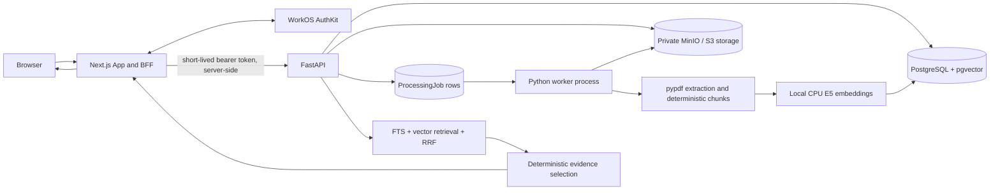
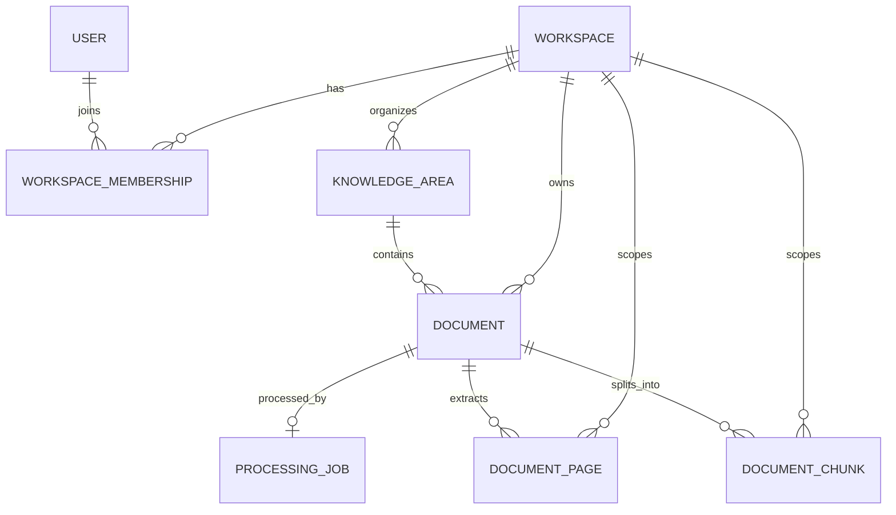
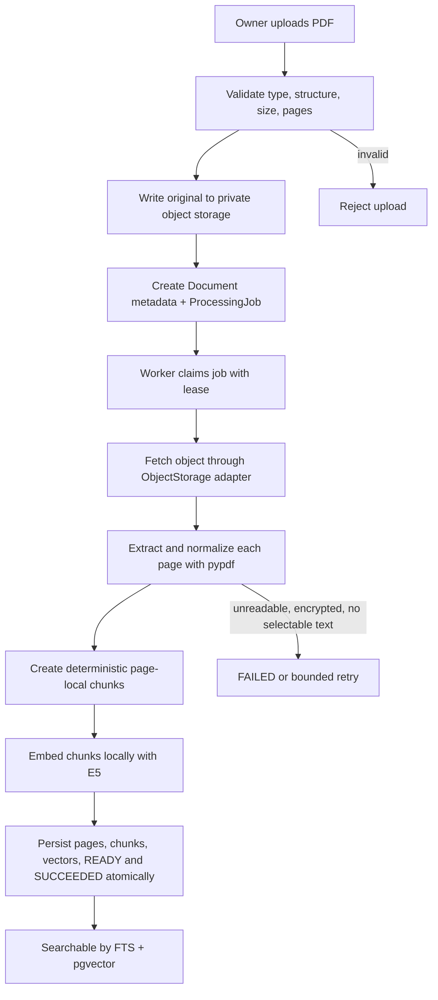
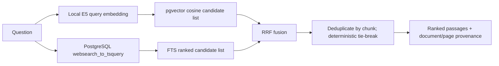
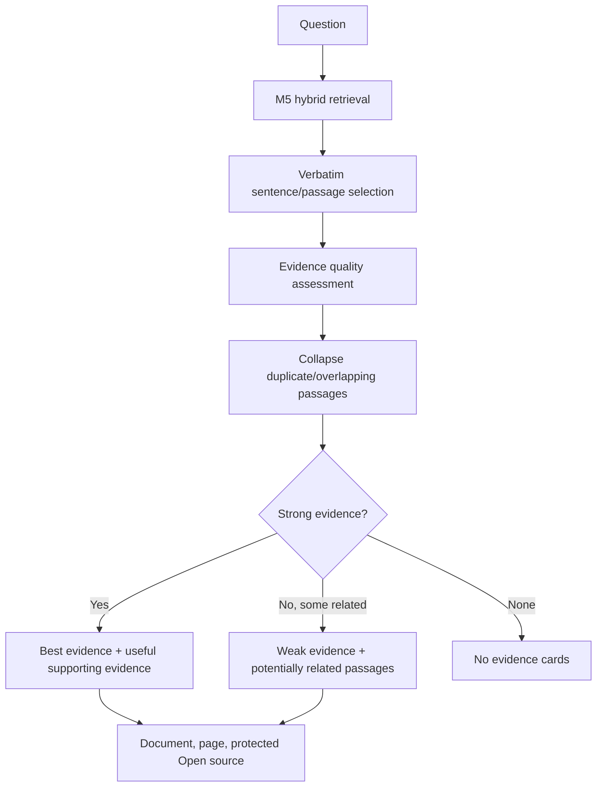

# KnowFlow Engineering Guide

**Current-state technical guide | M1-M7 | 13 October 2026**

This guide describes the implementation currently in this repository. Code and migrations are the authority when an older plan differs. It is written to help you run, trace, debug, and explain KnowFlow, not to document every line of generated or boilerplate code.

> **V1 AI boundary:** KnowFlow does not use a generative LLM. Ask KnowFlow does not write, summarize, or paraphrase an answer. It retrieves and presents passages from authorized source documents. Local E5 embeddings support retrieval; they are not a chatbot and do not call a paid inference API.

## 1. KnowFlow at a glance

Organizations keep policies, procedures, handbooks, and technical guidance in separate files and folders. Finding the applicable passage takes time, and a search result is only useful if the person can verify its source.

KnowFlow provides a workspace for managing those documents and locating relevant, page-aware passages. A workspace can organize documents into **Knowledge Areas**, for example HR, Engineering, IT & Security, and Operations.

- **Owner:** manages Knowledge Areas, documents, and workspace membership; can also search and ask questions.
- **Member:** browses authorized areas and documents, downloads sources, searches, and asks questions. Members do not receive the Owner's management capabilities.
- **Ask KnowFlow:** takes one natural-language question and returns best matching evidence, optional supporting evidence, or clearly labeled potentially related passages. It is not a chat or conversation history.

A typical flow is: an Owner creates a workspace, creates a Knowledge Area, and uploads a text-based PDF. A background worker extracts page text, chunks it, and creates local embeddings. When processing completes, Owners and Members can search or ask questions. The result identifies the document and page, and its protected source link opens the original document.

**V1 deliberately excludes** generative answers, OCR, chat history, DOCX/image ingestion, document version comparison, and analytics infrastructure. Weak evidence is not presented as an answer. The user inspects the source and interprets it.

### KnowFlow in 30 seconds

> KnowFlow is a multi-tenant document knowledge platform. Teams organize private PDFs into workspaces and Knowledge Areas. A PostgreSQL-backed worker extracts page-aware passages and local E5 embeddings. PostgreSQL full-text search and pgvector find candidate passages, and Ask KnowFlow presents selected verbatim evidence with protected document/page sources. WorkOS authenticates people; KnowFlow workspace memberships authorize access. V1 has no generative LLM or paid AI inference dependency.

## 2. Current system architecture

The application is a **modular monolith**: one backend codebase contains identity, tenancy, document, processing, embedding, and search modules. The API and worker run as separate processes from the same backend image. This keeps code boundaries clear without making each module a separately operated service.



**Component responsibilities**

- **Browser:** displays the application and submits user actions. It receives an encrypted HttpOnly session cookie, not the backend bearer token.
- **Next.js frontend/BFF:** renders pages, performs server-side session handling, calls FastAPI, and streams authorized document content back to the browser. The BFF is a Backend-for-Frontend: a server-side layer that adapts the API for the web UI while keeping credentials out of browser JavaScript.
- **WorkOS AuthKit:** handles the identity flow, account verification, and sign-in session. It answers “who signed in?”; it does not assign KnowFlow workspace roles.
- **FastAPI:** validates API credentials, checks membership and roles, validates requests, orchestrates services, and reads/writes PostgreSQL and object storage.
- **PostgreSQL:** stores users, workspaces, memberships, areas, document metadata, processing jobs, extracted pages, chunks, and vectors. pgvector adds a vector column and similarity operators to PostgreSQL.
- **MinIO:** local S3-compatible private object storage for original PDF bytes. Production can use a compatible private object store. PostgreSQL stores metadata and an opaque storage key, not the PDF bytes.
- **Worker:** polls PostgreSQL, claims a job safely, downloads its PDF through the storage abstraction, extracts/chunks text, creates local embeddings, and commits derived output.
- **E5 model:** a pretrained text embedding model run on CPU in the API and worker processes. It maps text to numeric vectors; it does not generate prose.
- **Retrieval and evidence layers:** M5 finds candidate passages with lexical and semantic search. M6 evaluates and groups evidence deterministically; it does not call an LLM.

## 3. Technology stack

| Technology | Purpose in KnowFlow | Why it was chosen |
|---|---|---|
| Next.js | Web pages, server rendering, server actions, BFF routes | Keeps authenticated browser-to-API work on the server and supports a coherent full-stack app. |
| React | UI components and interactive controls | Provides the component model used by Next.js. |
| TypeScript | Frontend types and compile-time checks | Catches interface mistakes in application code before runtime. |
| FastAPI | REST API | Python API framework with request validation, dependency injection, and OpenAPI support. |
| Python | API, worker, processing, embeddings | Shares the document pipeline and model runtime in one backend codebase. |
| PostgreSQL | Relational source of truth and durable jobs | Supports transactions, constraints, FTS, and the expected modest V1 workload. |
| pgvector | `vector(384)` storage and cosine retrieval | Keeps vector search beside tenant and document records without another database. |
| SQLAlchemy | ORM and database access | Models the relational schema and supports explicit tenant-scoped queries. |
| Alembic | Schema migrations | Applies a versioned database change sequence from checked-in revisions. |
| MinIO / S3-compatible storage | Private original PDF storage | Separates larger binary files from relational records and allows a storage adapter. |
| Docker / Compose | Local service environment | Starts web, API, worker, database, and object storage consistently. |
| WorkOS AuthKit | Managed user authentication | Avoids implementing password, verification, and recovery systems in the app. |
| pypdf | PDF parsing and page text extraction | Extracts selectable text and preserves page numbers; OCR is outside V1. |
| `intfloat/e5-small-v2` | Local text embeddings | Compact 384-dimension English retrieval model with CPU inference and no API key. |
| GitHub Actions | Continuous integration | Runs backend and frontend quality gates on pull requests and main pushes. |

## 4. Repository structure

Current source paths (generated `.next`, `node_modules`, and caches are omitted):

```text
.
├── README.md
├── docker-compose.yml
├── .env.example
├── .github/workflows/ci.yml
├── apps/web/
│   ├── Dockerfile
│   ├── src/proxy.ts
│   ├── src/lib/{api.ts,require-api-success.ts,ui-helpers.mjs}
│   ├── src/app/actions.ts
│   ├── src/app/api/workspaces/[workspaceId]/
│   │   ├── ask/route.ts
│   │   ├── search/route.ts
│   │   └── documents/[documentId]/content/route.ts
│   ├── src/app/components/{ConfirmSubmit,PendingSubmitButton}.tsx
│   └── src/app/workspaces/
│       ├── page.tsx
│       └── [workspaceId]/
│           ├── layout.tsx, WorkspaceNavigation.tsx, page.tsx
│           ├── search/{page.tsx,SearchForm.tsx}
│           ├── documents/{page.tsx,[documentId]/page.tsx}
│           ├── knowledge-areas/page.tsx
│           └── members/page.tsx
├── apps/web/tests/ui-helpers.test.mjs
├── backend/
│   ├── Dockerfile, pyproject.toml, alembic.ini
│   ├── app/
│   │   ├── main.py
│   │   ├── core/{config.py,errors.py}
│   │   ├── db/{models.py,session.py}
│   │   ├── identity/, tenancy/, knowledge_areas/, documents/
│   │   ├── jobs/, processing/, embeddings/, search/
│   │   └── api/health.py
│   ├── migrations/
│   │   ├── env.py
│   │   └── versions/
│   │       ├── 0001_enable_pgvector.py
│   │       ├── 0002_identity_and_tenancy.py
│   │       ├── 0003_knowledge_areas_and_documents.py
│   │       ├── 0004_processing_jobs_and_chunks.py
│   │       └── 0005_embeddings_retrieval.py
│   └── tests/ (API, processing, embedding, retrieval, PostgreSQL)
└── docs/
    ├── KNOWFLOW_ENGINEERING_GUIDE.md / .pdf
    ├── knowflow-v1-design.md
    ├── adr/0001...0011
    └── samples/ (development/test PDFs)
```

- `apps/web/src/app/workspaces/[workspaceId]/layout.tsx` is the shared authenticated workspace shell. Its child pages share the top bar and workspace navigation.
- `apps/web/src/app/actions.ts` contains server actions for form operations. Server actions call the server-only API helper rather than making the browser responsible for bearer credentials.
- `apps/web/src/app/api/...` contains Next.js BFF routes for Ask, search, and protected PDF streaming.
- `apps/web/src/lib/api.ts` centralizes server-side API calls; `proxy.ts`, AuthKit routes, and callback implement the login/session boundary.
- `backend/app/<domain>/` groups API routes and services by concern. `main.py` mounts the routers.
- `backend/app/db/models.py` is the current SQLAlchemy model definition; `db/session.py` creates the engine and request session dependency.
- `backend/app/jobs/` claims and runs durable document-processing work. `processing/` contains parsing, normalization, chunking, and atomic persistence. `embeddings/` isolates the local model provider. `search/` implements M5 retrieval and M6 evidence selection.
- `backend/migrations/versions/` contains the actual schema history through revision 0005.
- `backend/tests/` separates API, job, processing, embedding, evidence, and PostgreSQL-specific coverage. SQLite fixtures are not a substitute for pgvector/FTS integration tests.
- `docs/adr/` records accepted design decisions. `docs/samples/` are fixtures and are not special-cased in production logic.

## 5. Database architecture

SQLAlchemy models are in `backend/app/db/models.py`; migrations in `backend/migrations/versions/` define what PostgreSQL has actually been instructed to create.



| Model / table | Purpose and important fields |
|---|---|
| `User` / `users` | Internal user ID (UUID), immutable WorkOS `auth_subject`, normalized email, verification state, display name, timestamps. `auth_subject` and email are unique. |
| `Workspace` / `workspaces` | Tenant root: UUID, name, unique slug, creator, timestamps. |
| `WorkspaceMembership` / `workspace_memberships` | Join table for users and workspaces. Composite primary key `(workspace_id, user_id)`, role `OWNER` or `MEMBER`, creator and timestamps. It is the authorization authority. |
| `KnowledgeArea` / `knowledge_areas` | Workspace organization unit with name, normalized name, optional description, creator, timestamps. `(workspace_id, normalized_name)` is unique. |
| `Document` / `documents` | PDF metadata, workspace and area, uploader, original filename, opaque `storage_key`, content type, byte/page counts, SHA-256, lifecycle and deletion/processing fields. The actual PDF bytes are stored elsewhere. |
| `ProcessingJob` / `processing_jobs` | One durable `PROCESS_DOCUMENT` job per workspace/document. Includes state, attempt count, max attempts, availability, lease timestamp/owner/token, safe error code/message, and completion time. |
| `DocumentPage` / `document_pages` | Extracted normalized text and hash for each 1-based source page. `(document_id, page_number)` is unique. |
| `DocumentChunk` / `document_chunks` | Ordered text chunk, content hash, inclusive page range, nullable token count, `vector(384)`, model/version/dimension metadata, and embedding timestamp. The FTS expression has a GIN index. |

### IDs, relationships, and integrity

UUIDs provide opaque identifiers that are convenient across API boundaries; they are not access control. Tenant-owned records include `workspace_id`. Composite foreign keys, for example `(workspace_id, document_id)` from a chunk to a document, make it impossible to attach a chunk from one workspace to a document in another workspace even if the IDs are valid individually.

The `DocumentChunk` vector is nullable in the schema because rows may be constructed before embedding or during controlled migration states. The check constraint requires embedding model, version, fixed dimension 384, and timestamp to be present together with a vector. Current normal worker success persists fully embedded chunks; retrieval further filters to the configured model identity/version/dimensions.

### Authorization versus integrity

A database constraint answers “are these rows structurally consistent?” It does not answer “may this user read them?” FastAPI first checks internal membership and then uses workspace-scoped SQL. Composite constraints provide a second line of defense against invalid relationships; they do not replace authorization.

Original PDFs are in object storage because the database is better suited to relational metadata, transactions, and derived searchable text than large binary payloads. The database stores an opaque storage key and digest. MinIO URLs and raw vector values are not sent to users.

## 6. Authentication and authorization

**Authentication** establishes who the caller is. **Authorization** decides what that user can do in a specific workspace.

```mermaid
sequenceDiagram
    actor User
    participant Browser
    participant Next as Next.js / AuthKit BFF
    participant WorkOS
    participant API as FastAPI
    participant DB as PostgreSQL
    User->>Browser: Choose sign in
    Browser->>Next: /sign-in
    Next->>WorkOS: OIDC authorization + PKCE
    WorkOS-->>Browser: Redirect to /callback with code/state
    Browser->>Next: AuthKit callback
    Next->>WorkOS: Exchange code; validate PKCE
    WorkOS-->>Next: Session and short-lived access token
    Note over Next,Browser: Browser keeps only sealed HttpOnly session cookie
    Next->>API: Bearer JWT from server-side request
    API->>WorkOS: Verify JWT signature using JWKS; check issuer/audience/expiry
    API->>DB: Map immutable sub to internal User
    API->>DB: Check workspace_memberships for requested workspace
    DB-->>API: User + OWNER/MEMBER membership
```

The actual flow is implemented across `apps/web/src/proxy.ts`, `apps/web/src/app/sign-in/route.ts`, `callback/route.ts`, `apps/web/src/lib/api.ts`, `backend/app/identity/workos.py`, `identity/dependencies.py`, and `identity/service.py`.

1. AuthKit performs the OIDC authorization-code flow with PKCE. PKCE binds the callback to the sign-in request and helps prevent code interception/replay.
2. Next.js stores the session in a sealed HttpOnly cookie. HttpOnly prevents normal browser JavaScript from reading it. Server components/actions obtain a short-lived access token and make a server-to-server FastAPI request.
3. FastAPI checks the RS256 JWT using WorkOS JWKS (public signing keys), expected issuer, configured audience, expiry, and required subject. An audience is the API identifier the token is intended for.
4. The immutable WorkOS `sub` is mapped to `User.auth_subject`; mutable email is profile data, not the identity key.
5. `require_workspace_access()` checks `(user_id, workspace_id)` in `workspace_memberships`. `require_owner()` gates Owner actions. The backend is authoritative even if a UI control is hidden.

WorkOS Organizations/Roles are not used for KnowFlow authorization. Workspace creation gives the creator the initial Owner membership. Membership provisioning accepts an already registered, verified WorkOS user; V1 has no email invitation workflow.

## 7. Multi-tenancy and security

- **Membership first:** `backend/app/tenancy/policies.py` loads the workspace only through a matching membership. A non-member receives 404, which avoids disclosing whether another tenant's workspace exists.
- **Role checks:** Owners manage areas, documents, and membership. Members can read the permitted workspace content and ask/search. Some Owner-only actions return 403 when the workspace itself is accessible.
- **Workspace-scoped queries:** service methods carry `WorkspaceAccess` and constrain records by that workspace. Search filters the workspace and only active `READY` documents with current embeddings before returning candidate text.
- **Composite integrity:** composite foreign keys tie documents to an area and jobs/pages/chunks to the same workspace/document pair.
- **No PostgreSQL RLS in V1:** application-level membership checks and scoped SQL are explicit and tested. RLS would add a second policy/configuration system and session context requirement. It remains a possible defense-in-depth measure, not a current feature.
- **Private source access:** object storage is not public. The browser accesses the original through a Next.js route that forwards a short-lived token; FastAPI checks membership and document ownership before streaming. Knowing a document UUID or source path does not grant access.
- **Safe exposure:** response schemas omit vectors. The UI sees filename, text, page, and protected app route, not storage keys or object-store URLs. Request errors are mapped to safe messages; diagnostic details remain server side.

These mechanisms are covered by `backend/tests/test_tenancy_api.py`, `test_documents_api.py`, `test_search.py`, and `test_postgres_retrieval.py` among others. Tests verify foreign workspace IDs do not expose documents, chunks, or retrieval results.

## 8. Document lifecycle



### Upload path

`apps/web/src/app/workspaces/[workspaceId]/documents/page.tsx` submits an Owner upload using a server action in `apps/web/src/app/actions.ts`. The Next.js server calls FastAPI using `apiFetch`. `backend/app/documents/router.py` checks access and delegates to `documents/service.py`; `documents/validation.py` enforces a PDF structure and limits. Current defaults are 20 MiB and 250 pages; password-protected PDFs are unsupported. The stored metadata records `application/pdf`, byte size, page count, SHA-256, original filename, and an opaque key.

The service writes the private object using `ObjectStorage` (`documents/storage.py`) and then commits document metadata and the `PROCESS_DOCUMENT` job together. If the database commit fails after a successful object write, the service attempts a compensating object delete. Cross-system storage and database writes cannot be one atomic transaction, so compensation and retryable cleanup handle partial failure.

### Lifecycle states

- `UPLOADED`: accepted and waiting for worker processing or reprocessing.
- `PROCESSING`: a worker has claimed the job or a retry is pending.
- `READY`: extracted pages, chunks, and valid current-model vectors were committed.
- `FAILED`: processing exhausted retries or hit a permanent input/configuration failure.
- `DELETING`: access has been revoked and physical cleanup/tombstone handling is underway.

The API returns document status and safe processing error information. The frontend shows Uploaded, Processing, Ready, or Failed and explains that a document is searchable only once Ready.

## 9. Worker and PostgreSQL job queue

The queue is a row in `processing_jobs`, not a separate Redis/Celery/RabbitMQ service. PostgreSQL is already required, the portfolio workload is modest, and a committed row survives process restarts.

### Claim and concurrency

`backend/app/jobs/service.py:lock_next_eligible_job()` selects eligible work in stable order and issues `SELECT ... FOR UPDATE SKIP LOCKED LIMIT 1`. A row lock protects a selected job while it is claimed. `SKIP LOCKED` lets a second worker skip that row and claim another one instead of waiting for or duplicating the same job. PostgreSQL is required for this behavior; SQLite tests cannot prove it.

A successful claim increments `attempt_count`, sets `RUNNING`, stores `locked_at` and `locked_by`, assigns a random `lease_token`, and marks the document `PROCESSING`. The token is a **fencing token**: every heartbeat/final write must present the current token. If an old worker resumes after its lease has expired and another worker has claimed the job, its stale token prevents its result from overwriting the newer attempt.

### Heartbeat, timeout, retries

The worker polls every 2 seconds (`POLL_INTERVAL_SECONDS`). The configured lease is 90 seconds and heartbeat 30 seconds; the 600-second processing timeout is separately configurable. A heartbeat refreshes `locked_at`. If the process crashes, the lease eventually expires and the job becomes claimable again. If the worker is deliberately shut down, the process exits cleanly; uncompleted work is recovered through lease expiry.

`record_failure()` distinguishes retryable errors (for example temporary storage/model transport/runtime errors) from permanent document/configuration errors (for example malformed/encrypted PDF or incompatible vector output). Retry delay defaults are 30, 120, and 600 seconds with up to four attempts. The same job row records the current attempt count and last safe error; V1 does not store an immutable row for every attempt.

### Idempotency and atomic completion

**Idempotency** means repeating work produces the same intended state rather than duplicate/corrupt output. `persist_processed_output()` verifies job ID, workspace/document IDs, `RUNNING` state, and fencing token. Inside one database transaction it deletes prior page/chunk rows for that document, inserts the new pages/chunks, marks the document `READY`, and the job `SUCCEEDED`. If the transaction fails, none of those database changes commit. If the source was deleted, it cancels work and does not restore access or write chunks.

The worker logic is in `backend/app/jobs/worker.py`, with claim/retry behavior in `jobs/service.py` and transactional output in `processing/persistence.py`.

## 10. PDF extraction and chunking

KnowFlow accepts text-based/selectable PDFs only. `backend/app/processing/extraction.py:extract_pdf_pages()` retrieves an object through the storage abstraction, verifies byte length and SHA-256 against upload metadata, then uses `pypdf.PdfReader` to extract pages from 1 onward. Encrypted, malformed, missing, integrity-mismatched, and no-meaningful-text PDFs produce explicit safe processing errors. OCR is not performed.

`normalize_page_text()` applies Unicode NFKC normalization, removes null/soft-hyphen characters, standardizes line endings and collapses whitespace while retaining useful paragraph boundaries. Every page has a stable content hash and its original 1-based page number.

`backend/app/processing/chunking.py:chunk_pages()` processes pages in page order. Defaults are **1,800 characters per chunk and 240 characters of overlap** (`KNOWFLOW_CHUNK_SIZE_CHARS`, `KNOWFLOW_CHUNK_OVERLAP_CHARS`). It prefers a paragraph break, then a sentence break, then whitespace, otherwise a hard boundary. It never crosses page boundaries in the current implementation. Chunk indices are zero-based within the document; each chunk stores `page_start` and `page_end` (equal for current page-local chunks) and a content hash.

Page-aware chunks preserve the link from a search hit back to a PDF page. Overlap reduces the chance that a relevant sentence at a boundary loses its nearby context. Character-based splitting is deterministic and simple; it is not a semantic paragraph parser, and the embedding model truncates each input beyond its 512-token context.

## 11. Local embeddings

An **embedding** is a list of numbers that represents text in a space where texts with related meaning often have nearby vectors. It supports similarity search; it does not produce an answer or new text.

KnowFlow uses the pretrained Sentence Transformers-compatible model **`intfloat/e5-small-v2`**, pinned to revision `ffb93f3bd4047442299a41ebb6fa998a38507c52`. It is MIT-licensed, approximately 133 MB for the selected model file, has 384 output dimensions and supports up to 512 tokens. Inference uses CPU and does not require an API key, GPU, paid service, or model training. Approximate process memory including Python/PyTorch and model weights is 1-2 GB per loaded process; API and worker each load their own model instance.

The provider contract is `backend/app/embeddings/provider.py`; `sentence_transformers.py` validates the model identity, vector length, and finite values. Document text gets the prefix `passage: `; search/Ask questions get `query: `. This is the E5 retrieval convention. Embeddings are normalized and then stored directly on `document_chunks.embedding` as `vector(384)`. The row also stores model ID plus immutable revision, pipeline `embedding_version`, dimensions, and `embedded_at`. That metadata prevents vectors from different model revisions from silently mixing.

The Compose `model_cache` volume is mounted at `/models` and shared by API and worker. The first successful model load downloads the pinned files from Hugging Face, so initial setup requires internet. The cache completion marker makes later model loads local-only; ordinary `docker compose down` preserves it. `docker compose down -v` removes it. Weights are not committed to Git. Docker/Linux install the CPU-only PyTorch wheel; macOS inference is also configured to CPU.

Example: the user asks, “How much vacation time do staff get?” The stored policy says, “Full-time employees receive 25 working days of paid annual leave per calendar year.” FTS may have little exact token overlap between “vacation” and “annual leave.” E5 can place the two texts near each other because it was trained to represent related meaning. The retrieved source remains the actual quote; KnowFlow does not rewrite it as an answer.

## 12. Hybrid retrieval



**PostgreSQL full-text search (FTS)** converts text to language-aware lexemes and matches a web-style query. The search service uses `websearch_to_tsquery('english', ...)`, `to_tsvector('english', chunk.text)`, `ts_rank_cd`, and a GIN expression index. FTS is good at exact words and policy terms, but misses synonyms and paraphrases.

**Vector search** embeds the question locally and orders stored vectors by pgvector cosine distance. Cosine similarity compares vector direction; normalized vectors allow the service to derive similarity as `1 - cosine_distance`. It is useful for paraphrases, but a semantically related passage can still be the wrong policy or only a test/reference question.

`backend/app/search/service.py:retrieve()` performs the two candidate queries independently and requires the requested workspace, an active non-deleted `READY` document, and vector metadata matching the configured model/version/dimension. It validates an optional Knowledge Area belongs to that workspace; an inaccessible area ID returns 404.

The defaults are 30 FTS candidates, 30 vector candidates, 6 final results, and **RRF `k=60`**, all configurable. Reciprocal Rank Fusion uses `1 / (k + rank)` for each list; it combines rank positions instead of adding raw FTS scores to cosine similarities, whose scales are different. A chunk appearing in both lists accumulates both contributions. Deterministic IDs/indexes break ties. RRF ranks are not calibrated probabilities.

The REST response includes chunk/document IDs, filename, text, page range, rank, RRF score, and optional component ranks. Internal keyword score and cosine similarity fields are excluded from the public M5 schema. No vector is exposed. `POST /api/v1/workspaces/{workspace_id}/search` is available to both workspace roles.

## 13. Ask KnowFlow: M6 evidence, not generation



`POST /api/v1/workspaces/{workspace_id}/ask` calls the same M5 retrieval helper as `/search`; it does not duplicate or change the retrieval algorithm. It then runs `backend/app/search/evidence.py:select_evidence()`.

### What the evidence layer does

1. **Passage extraction:** `extract_passage()` splits retrieved chunk text into sentences and scores sentence overlap, answer-type cues, declarative structure, question-like structure, and reference markers. It chooses source sentences and short adjacent context when useful. It only normalizes whitespace; it never paraphrases. If a safe smaller passage cannot be isolated, the original chunk is used.
2. **Quality assessment:** the selector evaluates substantive declarative content and checks for question/reference material. Query terms are normalized with lightweight morphology and generic words removed. Lexical support combines FTS presence, meaningful term overlap, and distinguishing-concept coverage. For semantic support it uses the actual candidate cosine similarity from M5, not its rank or RRF score. The configured minimum vector similarity is 0.72, but it only contributes with substantive evidence and a compatible answer-type cue (frequency, quantity, timing, or responsible role). These are heuristics, not a probability.
3. **Deduplication:** normalized extracted text is compared across all candidates; near duplicates use token-set Jaccard similarity with default threshold 0.72. Same-document/same-page overlapping chunks also collapse. The best passage cannot reappear as supporting evidence. Supporting passages must add context; the default three is a maximum, not a quota.
4. **Evidence state:** `evidence_found` may return best and supporting evidence. `weak_evidence` has no best/supporting cards and may return only `related_evidence` with an explicit weak label. `no_evidence` returns no evidence cards. The normal UI hides engineering rank and score details.
5. **Provenance:** every evidence item carries document ID/title, page start/end, and an application `source_path`. The frontend route opens a protected document page and adds a PDF page fragment. FastAPI checks membership/document scope again when streaming the original.

When separate policies disagree, KnowFlow presents each source passage with its own provenance. It does not synthesize or reconcile a single rule. This avoids pretending that one document overrides another. A deterministic evidence selector is not general natural-language reasoning: ambiguous or unusual questions may be missed or classified weakly. Semantic similarity by itself is insufficient evidence that a passage answers the requested concept.

## 14. Frontend and user experience

The shared workspace layout in `apps/web/src/app/workspaces/[workspaceId]/layout.tsx` fetches the authorized workspace on the server and renders the KnowFlow top bar, role, workspace switch, sign-out form, and navigation.

- **Overview:** `[workspaceId]/page.tsx`; summarizes existing area/document/status information and gives a path to Ask. It is not an analytics service.
- **Ask KnowFlow:** `[workspaceId]/search/page.tsx` and `SearchForm.tsx`; one question at a time, explicit loading/error/empty/evidence states, source pages, no chat bubbles or persisted conversation.
- **Knowledge Areas:** `[workspaceId]/knowledge-areas/page.tsx`; browsing for Members and management controls for Owners.
- **Documents:** `[workspaceId]/documents/page.tsx`; upload and library, status, protected source actions; Owner management controls. The document detail page includes the protected PDF viewer.
- **Members:** `[workspaceId]/members/page.tsx`; Owner management controls, subject to final Owner protections in the backend.
- **Navigation:** desktop uses the left sidebar; mobile/tablet hides that sidebar and shows a header hamburger menu. The menu has all five destinations, active-page indication, `aria-expanded`, `aria-controls`, Escape handling, and closes after navigation. Desktop and mobile use the same destination list.

### Next.js rendering and BFF boundaries

Server Components are rendered on the server by default and are used for authenticated data loading. Client Components are limited to interactions that need browser state, such as the Ask form or mobile menu. Server Actions handle form submissions. BFF route handlers in `apps/web/src/app/api/...` adapt Ask/search requests and stream protected document content. They call `apiFetch` with a server-held token; they do not pass that token to client JavaScript. FastAPI remains the API/security boundary and independently authorizes each request.

M7 adds visible pending states (`PendingSubmitButton`), explicit confirmation (`ConfirmSubmit`), accessible labels and focus indicators, textual document status, safe generic error UI, and responsive layouts. It does not add an alternate client data store or change backend policy. The frontend helper suite is in `apps/web/tests/ui-helpers.test.mjs`; backend tests remain the authority for security behavior.

## 15. Document deletion

Deletion separates **logical revocation** from **physical cleanup**. PostgreSQL cannot commit a transaction that atomically includes an object-store delete, so the app first commits a `DELETING` tombstone and `deleted_at`. It cancels unfinished processing jobs and deletes pages/chunks immediately. Workspace-scoped API reads, downloads, search, and worker selection exclude the deleted document, so access is revoked before storage availability is known.

The service then deletes the original object through the adapter. If storage is temporarily unavailable, the tombstone records a safe cleanup error and remains inaccessible; a repeated Owner delete operation can retry for up to the configured 24-hour cleanup window. After physical cleanup succeeds, `cleanup_completed_at` is set and `purge_after` is 7 days later. `purge_expired_tombstones()` removes eligible metadata opportunistically during document/area operations; there is no separate scheduled cleanup worker. After the retry window expires without cleanup, the API returns a safe operator-attention error while preserving the tombstone.

## 16. Docker and local development

Compose services and named volumes are defined in `docker-compose.yml`.

| Service | Role | Persistent data / ports |
|---|---|---|
| `web` | Next.js development server | `web_node_modules`, `web_next_cache`; port 3000 |
| `api` | FastAPI development server | mounts backend source and shared `model_cache`; port 8000 |
| `worker` | Same backend image, separate process | mounts backend source and shared `model_cache`; no public port |
| `db` | PostgreSQL 16 with pgvector | `postgres_data`; port 5432 |
| `object-store` | MinIO S3-compatible API and console | `object_store_data`; ports 9000 and 9001 |

The model cache volume persists independently. `HF_HOME` and `SENTENCE_TRANSFORMERS_HOME` point at `/models`.

```sh
docker compose up --build -d
docker compose run --rm api alembic upgrade head
docker compose logs -f worker
docker compose down
```

- `up --build -d` builds images, creates the network/volumes if needed, starts services in dependency order, and returns without attaching to logs. Database readiness gates API/worker startup; MinIO is a started dependency.
- `run --rm api alembic upgrade head` starts a temporary API-image container, connects it to Compose services, applies all unapplied migrations to the latest revision, then removes that one-off container. It does not generate migrations.
- `logs -f worker` follows the worker's polling and processing logs.
- `down` stops/removes containers and the Compose network but preserves named volumes and local database, object-store, dependency, and model-cache data.

> `docker compose down -v` removes the named volumes too. It deletes the local PostgreSQL database, uploaded MinIO files, and downloaded model cache (as well as web dependency/cache volumes). Use it only when intentionally resetting local data.

Copy `.env.example` to `.env`, configure WorkOS AuthKit callback/redirect values and audience, then start services. Local default database/object-store credentials are development-only. Apply migrations before readiness-dependent flows. On first model initialization, internet is needed to fetch the pinned E5 files; after the completion marker is written, the shared cache supports local-only loading.

## 17. Database migrations

Alembic is configured by `backend/alembic.ini` and `backend/migrations/env.py`. The environment imports `Base.metadata`, reads the configured database URL, and uses the ordered `revision` / `down_revision` links below. Alembic records the current revision in `alembic_version`.

| Revision | Current migration purpose |
|---|---|
| `0001_enable_pgvector` | Enables the PostgreSQL `vector` extension. |
| `0002_identity_and_tenancy` | Creates users, workspaces, and Owner/Member memberships. |
| `0003_areas_documents` | Adds Knowledge Areas, document metadata/tombstones and workspace constraints/indexes. |
| `0004_processing_jobs_chunks` | Adds processing error fields, durable jobs, extracted pages, chunks, indexes, and enqueues existing eligible M3 documents. |
| `0005_embeddings_retrieval` | Adds `vector(384)`, model/version/dimension/time metadata, embedding consistency constraint, FTS GIN index, and requeues eligible documents so the worker creates vectors. |

`alembic upgrade head` applies unapplied revisions in chain order. `alembic check` compares current SQLAlchemy metadata against the connected PostgreSQL schema and reports model/schema drift; it does not repair drift or write a migration. Migration 0005 does not run embeddings inside DDL; the normal worker path reprocesses active documents.

## 18. Testing

### Backend tests

| Test file | Main concern |
|---|---|
| `test_config.py` | Runtime configuration and production safety invariants. |
| `test_workos_auth.py` | JWT/JWKS validation and internal user mapping. |
| `test_tenancy_api.py` | Membership roles, workspace access, and member management. |
| `test_knowledge_areas_api.py` | Area authorization, validation, and tenant scope. |
| `test_documents_api.py` | PDF validation, object storage, listing, access, deletion, retries. |
| `test_jobs.py`, `test_postgres_job_concurrency.py` | Claiming, retry state, lease/concurrency behavior. |
| `test_processing.py` | Page extraction, chunking, worker lifecycle, failures, persistence. |
| `test_embeddings.py` | Local provider contract, prefixes, dimensions, errors and metadata. |
| `test_search.py`, `test_evidence.py` | RRF/API tenant behavior and deterministic evidence selection. |
| `test_postgres_retrieval.py` | Real PostgreSQL pgvector/FTS behavior, candidate ranks, provenance and filters. |

Most API/service tests use an isolated SQLite fixture and an auth dependency override. That proves application rules and general relational behavior, but SQLite does not implement PostgreSQL FTS, pgvector operators, PostgreSQL migration DDL, or `SKIP LOCKED` concurrency semantics. Those require a real PostgreSQL instance with pgvector and migrations. Model-provider unit tests use a fake provider/model to avoid downloads; sample PDF end-to-end retrieval requires the actual local model and Compose services.

### Frontend and commands

The frontend has a small dependency-free Node test suite (`apps/web/tests/ui-helpers.test.mjs`) for role-capability helpers, document status labels, safe Ask errors, and navigation/menu contracts. It is not a browser automation suite.

```sh
# Compose backend quality checks
docker compose run --rm api ruff check app tests migrations
docker compose run --rm api pytest
docker compose run --rm api pytest tests/test_postgres_retrieval.py tests/test_postgres_job_concurrency.py
docker compose run --rm api alembic check

# Frontend checks (or run in the web container)
cd apps/web
npm test
npm run lint
npm run typecheck
npm run build
```

The PostgreSQL integration tests need `KNOWFLOW_DATABASE_URL` to point to the Compose pgvector database, migrations applied, and test configuration. `docker compose run --rm api pytest` is the usual full backend suite; PostgreSQL-specific tests may be skipped unless that integration URL is configured, as reflected in the test fixtures/environment.

## 19. CI/CD

The only checked-in workflow is `.github/workflows/ci.yml`. It runs on pull requests and pushes to `main`, with repository contents read-only.

**Backend job:** Ubuntu runner starts `pgvector/pgvector:pg16` as a PostgreSQL service with a health check. It sets test environment/database URL, installs Python 3.12, caches pip inputs, installs the CPU-only `torch==2.8.0+cpu` wheel then the project/dev dependencies constrained by `constraints-linux-cpu.txt`, and runs Ruff, `alembic upgrade head`, `alembic check`, and `pytest`.

**Frontend job:** Ubuntu runner sets up Node 22 and npm cache, runs `npm ci`, then lint, TypeScript typecheck, and Next.js production build.

This is **continuous integration**, not deployment. The workflow does not publish images, deploy an environment, or run the frontend's `npm test` command. Public portfolio deployment is a later M8 task; no M8 implementation is present here.

## 20. Failure scenarios and safe behavior

| Failure | Current behavior |
|---|---|
| PostgreSQL unavailable | API database operations fail; readiness reports unhealthy. Worker cannot claim jobs and logs/retries the polling loop. No local data is invented. |
| MinIO unavailable during upload | Upload fails without a ready document; no public object URL is exposed. |
| Invalid, encrypted, over-limit, or over-page PDF | Upload validation rejects it; unsupported/scanned/no-text content fails processing explicitly. OCR is not attempted. |
| Object write succeeds, metadata/job transaction fails | Service rolls back SQL and attempts compensating object deletion. If compensation fails, it logs the opaque key for support. |
| Worker crashes | The job remains RUNNING until lease expiry. Another worker can reclaim it; the attempt count is bounded. |
| Local model download/cache fails | Worker does not claim a document job until model setup succeeds; a transient setup failure is logged and retried. Incomplete downloads do not establish the successful-cache marker. API search returns a safe provider error if model setup fails. |
| Embedding or extraction fails | Classified transient/permanent where possible; a safe error code/message and retry schedule are persisted. READY is only committed with pages/chunks/vectors. |
| Two workers see the same eligible job | PostgreSQL row locking with `SKIP LOCKED` allows only one claim; fencing token checks protect final writes. |
| Document deleted during or before work | Deletion revokes access, removes derived data and cancels the job. Worker claim/persistence also checks deletion and current lease. |
| User changes another workspace's ID | Membership check and workspace-scoped SQL produce 404 for inaccessible resources; composite constraints prevent cross-tenant associations. |
| Search/Ask fails | API returns a safe structured error. UI shows a generic retry message; internal scores and exceptions are not exposed. |
| Weak or unsupported question | Ask does not invent an answer. It labels weak related passages as such or shows no evidence cards. |

## 21. Architectural decisions and trade-offs

All current records are in `docs/adr/`. Decisions are scoped to V1; changing one requires an explicit scope/architecture discussion.

| ADR | Problem → decision | Benefit and trade-off |
|---|---|---|
| 0001 Modular monolith | Avoid distributed operations for a small portfolio product; use Next.js plus modular FastAPI and a separate worker process from the same backend code. | Clear code modules and independent API/worker processes; less independent scaling than true service boundaries, but easier operation. |
| 0002 WorkOS AuthKit | Avoid owning credentials, resets, and verification; use managed OIDC and server-side BFF cookies. | Strong identity boundary; external identity configuration and provider availability are required. |
| 0003 Application tenant checks | Use membership authorization, mandatory scoped SQL, and composite constraints; defer PostgreSQL RLS. | Explicit and testable; every query must retain scope, while constraints provide integrity rather than read authorization. |
| 0004 Object storage/deletion | Keep PDF bytes private in an adapter-backed object store; tombstone then clean up. | DB remains relational and access revokes immediately; object/DB cleanup needs retries because it is not one transaction. |
| 0005 Durable worker | Use one PostgreSQL job row per document, leases, `SKIP LOCKED`, retries, fencing and idempotent output; no Redis/Celery. | Durable with fewer services; polling/lease behavior must be maintained and measured. |
| 0006 Chunk/vector storage | Store one active vector on each chunk with page/hash/model metadata. | Simple retrieval join; model changes need controlled re-embedding and possibly schema changes. |
| 0007 Hybrid retrieval | Combine Postgres FTS and pgvector ranks using configurable RRF. | Exact terms and paraphrases complement each other; RRF improves ranking but is not calibrated confidence. |
| 0008 Product boundaries | Keep V1 to multi-user workspaces, areas, text PDFs, source evidence, no OCR/history/LLM. | Complete core journey without uncontrolled scope; users interpret evidence rather than receiving synthesized answers. |
| 0009 Public portfolio demo | At M8 choose a public demo host and prefer practical free tiers; don't reshape architecture in advance. | Cost-aware deployment choices later; public availability/security are still future work. |
| 0010 Local embedding model | Use pinned MIT `intfloat/e5-small-v2`, CPU, local cache, 384 dimensions. | No paid inference, API key or GPU; local CPU/RAM and first model download are required. |
| 0011 Evidence Q&A without generation | Return deterministic selected source passages; use lexical, semantic, structure, and answer-type signals. | No generative hallucination or question charge; no prose synthesis and heuristic classification can remain ambiguous. |

### Zero-charge portfolio constraint

The default portfolio app must not depend on usage-billed AI inference APIs. Document processing, embeddings, retrieval, and current evidence Q&A work without paid AI API calls. WorkOS remains the explicitly approved identity provider, separate from the AI inference constraint. No external paid AI provider or generative model is part of current V1.

## 22. End-to-end request traces

The paths below follow current request boundaries. File names are repository-relative.

### A. User signs in

`/sign-in` route and AuthKit middleware (`apps/web/src/app/sign-in/route.ts`, `src/proxy.ts`) → WorkOS authorization/PKCE → `/callback` route → sealed server session cookie → server-side `apiFetch()` obtains short-lived token → FastAPI `get_current_user()` verifies JWT → `resolve_authenticated_user()` maps `sub` to `User`.

### B. Workspace creation

`apps/web/src/app/workspaces/page.tsx` → `createWorkspace` in `apps/web/src/app/actions.ts` → server-only `apiFetch()` → `backend/app/tenancy/router.py:post_workspace` → `tenancy/service.py:create_workspace` → insert Workspace and initial OWNER `WorkspaceMembership` transactionally → return workspace list/redirect into workspace.

### C. Knowledge Area creation

`[workspaceId]/knowledge-areas/page.tsx` → server action in `actions.ts` → `POST /api/v1/workspaces/{id}/knowledge-areas` → `knowledge_areas/router.py` checks membership and Owner role → `knowledge_areas/service.py:create_knowledge_area` validates normalized name and scoped uniqueness → insert row with workspace ID → return updated list.

### D. PDF upload

`[workspaceId]/documents/page.tsx` multipart form → `uploadDocument` in `apps/web/src/app/actions.ts` → Next server calls `POST /api/v1/workspaces/{id}/documents` → `documents/router.py` checks Owner → `documents/validation.py` verifies structure/type/limits/page count → `documents/service.py:upload_document` writes via `ObjectStorage` → one SQL commit creates `Document` and `ProcessingJob` → UI shows Processing.

### E. Worker processing and embeddings

`python -m app.jobs.worker` → `run_worker()` loads local model before claiming work → `claim_next_job()` locks an eligible job with PostgreSQL `SKIP LOCKED`, assigns lease token → `process_claim()` reads PDF from `ObjectStorage`, calls `extract_pdf_pages()`, `chunk_pages()`, provider `embed(... purpose="document")` → `persist_processed_output()` verifies fence and atomically persists pages/chunks/vectors and READY/SUCCEEDED.

### F. Ask KnowFlow question

`[workspaceId]/search/SearchForm.tsx` → `POST /api/workspaces/{id}/ask` BFF route → server-side `apiFetch()` → FastAPI `ask_workspace()` checks membership → `_retrieve_for_workspace()` invokes `retrieve()` → query embedding + FTS + pgvector + RRF → `select_evidence()` extracts, assesses, ranks and deduplicates → `AskResponse` → UI renders evidence state and source cards.

### G. Open a source PDF at a cited page

Evidence `source_path` points to `/workspaces/{workspace}/documents/{document}?page=N` → authenticated document detail page loads metadata → PDF `<iframe>`/viewer route uses a page fragment → Next content BFF route requests FastAPI stream → `documents/router.py:read_document_content` rechecks membership and active document → adapter reads private object → Next streams content to browser. A page fragment is a browser viewer hint, not an authorization mechanism.

### H. Document deletion

Owner confirms delete in document UI → Server Action → `DELETE /api/v1/workspaces/{id}/documents/{id}` → `documents/service.py:mark_document_deleted()` checks Owner and workspace → commits tombstone, cancels unfinished job, deletes chunks/pages → private object cleanup → completion timestamp and purge date → no normal list/search/download returns the tombstoned document.

## 23. Important code to understand

### Essential: recommended reading order

1. `backend/app/db/models.py` — tables, enums, composite constraints, vector metadata.
2. `backend/app/identity/dependencies.py` and `backend/app/identity/workos.py` — JWT trust and current-user boundary.
3. `backend/app/tenancy/policies.py` — membership and Owner rules.
4. `backend/app/documents/router.py` and `backend/app/documents/service.py` — authenticated resource flow.
5. `backend/app/documents/storage.py` and `validation.py` — private object abstraction and PDF boundary.
6. `backend/app/jobs/service.py` — durable claim, leases, retry and fence.
7. `backend/app/jobs/worker.py` — processing orchestration.
8. `backend/app/processing/extraction.py`, `chunking.py`, and `persistence.py` — source-to-chunk pipeline and atomic completion.
9. `backend/app/embeddings/sentence_transformers.py` — local E5 contract.
10. `backend/app/search/service.py` and `backend/app/search/evidence.py` — M5 retrieval and M6 evidence selection.
11. `backend/app/search/router.py` and `schemas.py` — API boundary and response contracts.
12. `apps/web/src/lib/api.ts`, `apps/web/src/app/api/workspaces/[workspaceId]/ask/route.ts`, and `search/SearchForm.tsx` — BFF-to-Ask UI.
13. `apps/web/src/app/workspaces/[workspaceId]/layout.tsx` and `WorkspaceNavigation.tsx` — current shared shell and responsive navigation.

### Important

- `backend/app/main.py` — router mounting and error handlers.
- `backend/app/db/session.py`, `backend/app/core/config.py` — session lifecycle and validated settings.
- `backend/app/tenancy/service.py` — workspace/membership behavior and final Owner protection.
- `backend/app/documents/lifecycle.py` — tombstone purge timing.
- `backend/migrations/versions/0001...0005...` — actual schema history and M5 requeue.
- `backend/tests/test_postgres_retrieval.py`, `test_postgres_job_concurrency.py` — database-specific assurances.
- `.github/workflows/ci.yml`, `docker-compose.yml`, `backend/Dockerfile` — automation and runtime packaging.

### Useful later

- `apps/web/src/app/actions.ts` — all server form actions and redirects.
- `apps/web/src/app/workspaces/[workspaceId]/documents/[documentId]/page.tsx` — source viewer path.
- `apps/web/src/app/components/ConfirmSubmit.tsx`, `PendingSubmitButton.tsx` — M7 interaction primitives.
- `backend/tests/test_evidence.py`, `test_embeddings.py`, `test_processing.py` — focused behavioral contracts.
- `docs/adr/` — explain the design before changing it.

## 24. Interview preparation

### Explain KnowFlow in two minutes

> KnowFlow is a multi-tenant knowledge platform for internal business PDFs. WorkOS AuthKit authenticates users, while PostgreSQL `workspace_memberships` defines Owner/Member access. Owners organize documents into Knowledge Areas and upload private text-based PDFs. A separate worker from the FastAPI codebase claims durable PostgreSQL jobs, extracts page text with pypdf, creates deterministic page-aware chunks, and embeds them locally with a pinned CPU E5 model. PostgreSQL stores metadata and chunks; MinIO stores originals. Search combines PostgreSQL full-text search with pgvector cosine retrieval using Reciprocal Rank Fusion. Ask KnowFlow adds a deterministic evidence-quality layer, then displays verbatim source passages and protected document/page links. It does not generate answers or call a paid AI API. This demonstrates authentication boundaries, tenant isolation, relational modeling, asynchronous jobs, failure handling, object storage, testing, and practical search engineering.

### Explain KnowFlow technically in 5-10 minutes

Start with the identity boundary (AuthKit cookie in Next, server-side short-lived token, JWT/JWKS validation, immutable `sub` mapping). Explain that KnowFlow membership is the authorization source. Then describe the modular monolith and its two backend processes. Follow upload from validation through private object write and transactional metadata/job creation. Explain PostgreSQL `SKIP LOCKED`, leases, heartbeat and fencing token, then the pypdf/page/chunk/local embedding pipeline and atomic READY commit. For retrieval, contrast FTS and vector similarity, explain RRF, tenant/status/model filters, and why E5 is local. Finish with Ask's deterministic quality/deduplication/provenance layer, zero-LLM boundary, tests and trade-offs.

### Questions and model answers

1. **What problem does KnowFlow solve?** It lets a workspace organize internal PDFs and locate relevant policy passages with verifiable document/page provenance, instead of relying on manual file search.
2. **Is KnowFlow an AI application?** It uses a pretrained local embedding model for semantic retrieval. It does not train a model or use a generative LLM. Its core is still a full-stack document platform and retrieval system.
3. **What is an embedding?** A numeric representation of text that lets software compare semantic similarity. In KnowFlow E5 maps a query or passage to 384 numbers; it does not produce prose.
4. **Why E5-small-v2?** It is compact, English-focused, supports retrieval prefixes, produces 384 dimensions, is MIT-licensed, and runs locally on CPU without a paid API.
5. **What does `vector(384)` mean?** Each database vector has exactly 384 floating-point dimensions. The model, application settings, metadata constraint, and schema must agree.
6. **What is cosine similarity?** A measure of the angle/direction between two vectors. KnowFlow orders candidates by pgvector cosine distance and derives similarity for evidence assessment; it is not a calibrated answer probability.
7. **What is pgvector?** A PostgreSQL extension and SQLAlchemy type/operator support for storing and comparing vectors. It keeps vector search in the same database as tenant/document metadata.
8. **Why hybrid search?** FTS is strong for exact terms and numbers; vector search can find paraphrases. RRF combines their rank lists without pretending their raw scores share one scale.
9. **What is PostgreSQL FTS?** Native tokenization, query matching and ranking. KnowFlow uses an English `tsvector`, `websearch_to_tsquery`, `ts_rank_cd`, and GIN index.
10. **What is RRF?** Reciprocal Rank Fusion adds `1/(k+rank)` for each list where a passage appears. It provides a deterministic combined order; `k=60` is a configurable damping constant, not confidence.
11. **Why not only vector search?** Semantically close text can be a test question, a neighboring policy, or unsupported for the requested concept. Exact keywords and evidence checks help guard against that.
12. **Why not only keyword search?** Different vocabulary such as “vacation time” versus “annual leave” can have low token overlap even when the meanings match.
13. **How can “vacation time” find “annual leave”?** E5's query and passage vectors can be near even without exact terms. FTS is complementary; the retrieved source text remains unchanged.
14. **Why no generative LLM?** V1 must run core AI functionality without usage-billed APIs and on constrained hosting. Direct evidence avoids generated paraphrase/hallucination and keeps model/runtime needs small, at the cost of no synthesized answer.
15. **How does KnowFlow prevent hallucinated answers?** It does not generate answers. It classifies source passages and labels strong, weak, or no evidence; weak related text is not presented as the best answer.
16. **How do citations work?** Extraction stores 1-based page provenance; chunks carry page ranges; M6 carries those fields into the evidence response. Protected source routing checks authorization again before streaming the PDF.
17. **What happens when evidence is weak?** The API returns `weak_evidence`, no best/supporting evidence, and may include subordinate related passages. `no_evidence` returns no cards.
18. **How do you handle conflicting policies?** Each passage keeps its own document/page provenance. KnowFlow does not synthesize a compromise or decide which source governs.
19. **How is tenant isolation enforced?** Internal membership is checked first, every data query scopes by workspace, and composite FKs prevent cross-workspace dependent rows. Inaccessible workspace resources return 404.
20. **Why not PostgreSQL RLS?** Explicit service checks and SQL scope are the approved V1 model and are directly testable. RLS would require transaction/session context and a second policy system; it may be future defense-in-depth.
21. **Why WorkOS?** It handles managed identity and verification while Next keeps its sealed HttpOnly session server-side. FastAPI verifies the short-lived JWT independently; workspace roles remain local.
22. **Why MinIO/object storage?** PDF bytes are larger binary objects; object storage handles them while PostgreSQL stores metadata and derived text. A small interface keeps MinIO replaceable.
23. **Why a PostgreSQL-backed worker queue?** Jobs must survive restarts, and PostgreSQL is already running. It avoids another service at current scale; polling and leases are explicit maintenance responsibilities.
24. **What is `SKIP LOCKED`?** A PostgreSQL row-lock option that makes a worker skip rows another worker has locked, so multiple workers can claim different eligible jobs without waiting on the same one.
25. **What is idempotency here?** A repeat processing attempt replaces prior page/chunk output inside one transaction rather than adding duplicates. It only commits if its lease is still current.
26. **What is a fencing token?** A per-claim random lease token checked on heartbeats and persistence. A late worker with an old token cannot commit after another worker has taken over.
27. **What if a worker crashes?** Its row remains RUNNING until the lease expires. Another worker can reclaim it; attempt limits/backoff bound retries.
28. **How would you scale this?** Measure queue age, processing duration, DB query latency and corpus size first. Add worker replicas (already supported by row locking), tune indexes and CPU/cache. Consider approximate vector indexes or a dedicated queue only when measurements justify the complexity.
29. **What would you change for enterprise deployment?** Evaluate managed PostgreSQL/object storage, backups, secret management, observability, retention/compliance requirements, rate limits across replicas, and perhaps RLS as defense-in-depth. Preserve application authorization and test tenant isolation.
30. **Why a modular monolith?** One developer and one product do not need distributed service operations. Domain modules create boundaries now; API and worker can scale as separate processes, and extraction to services can wait for an independent scaling/team need.
31. **How are partial failures handled?** Upload compensates object writes if SQL fails; worker commits derived data and READY together; delete commits access revocation before attempting object cleanup and retains a tombstone for retry.
32. **What tests need PostgreSQL?** pgvector cosine operators, FTS ranking/index behavior, Alembic schema and `SKIP LOCKED` concurrency. SQLite fixtures test much application logic but cannot validate those PostgreSQL-specific behaviors.

## 25. Limitations and future work

### Current limitations

- Only text/selectable PDFs are supported; there is no OCR or DOCX/image ingestion.
- Ask KnowFlow does not generate, summarize, or paraphrase answers and has no persisted conversation history.
- Evidence classification is deterministic and heuristic. It can reject a valid unusual paraphrase or return weak related material; labels are not calibrated confidence values.
- No document version comparison/change intelligence, analytics platform, invitations workflow, billing, or enterprise granular permissions are implemented in V1.
- Tombstone purge is opportunistic during operations rather than driven by a scheduled cleanup service.
- The project is not deployed as a public demo yet; M8 has not started.

### Possible future improvements (not committed scope)

If actual users or measurements justify them, future discussions might consider OCR, version comparison, a scheduled cleanup worker, improved retrieval evaluation, a vector index for a larger corpus, stronger operational monitoring, or an optional generation feature. Generative AI and paid inference remain outside V1 and require explicit approval; none of these possibilities should be mistaken for current functionality or an approved milestone.

## 26. Learning roadmap

### Level 1: Explain the product and architecture

Read sections 1-4 and 21. Trace the architecture diagram and be able to explain the browser, BFF, API, database, object store, and worker roles. Files: `README.md`, `docker-compose.yml`, `backend/app/main.py`.

### Level 2: Trace identity and user requests

Read sections 6-8 and 14. Follow WorkOS `sub` through `get_current_user`, membership, a workspace-scoped router, and back through Next.js. Files: `apps/web/src/proxy.ts`, `apps/web/src/lib/api.ts`, `backend/app/identity/workos.py`, `identity/dependencies.py`, `tenancy/policies.py`.

### Level 3: Understand relational data and asynchronous work

Read sections 5, 8-10, 15, and 17. Draw the ER diagram from memory; explain composite FKs, the lease, fencing token, retries, and atomic persistence. Files: `backend/app/db/models.py`, all five migrations, `jobs/service.py`, `jobs/worker.py`, `processing/persistence.py`, `documents/service.py`.

### Level 4: Explain embeddings and retrieval

Read sections 11-13. Explain query/passage prefixes, vector dimensions, FTS, cosine distance, RRF, and why retrieval is not answer generation. Files: `embeddings/provider.py`, `embeddings/sentence_transformers.py`, `search/service.py`, `search/evidence.py`, `search/router.py`.

### Level 5: Explain trade-offs and failure handling

Read sections 20-25 and ADRs 0001-0011. Practice the interview questions. For each failure, explain which transaction or retry boundary contains it and what the user sees.

### Level 6: Debug and modify independently

Start Compose, apply migrations, inspect worker logs, run a focused API/processing test, and run PostgreSQL retrieval tests. Make a small change only after locating its owning module, request contract, tenant check, migration impact, and relevant tests. Commands are in sections 16 and 18.

## Appendix A. Milestone history

The main guide above describes the integrated current system, not a historical snapshot. Milestones were delivered incrementally: M1 foundation; M2 identity and tenancy; M3 Knowledge Areas/documents; M4 durable processing and chunks; M5 local embeddings and hybrid retrieval; M6 evidence-based Q&A without generation; M7 UX and application hardening. M5 superseded early M4-era descriptions that discussed unpopulated vectors or no search. M7 changed the frontend experience but intentionally preserved backend, retrieval, evidence, and database architecture.
